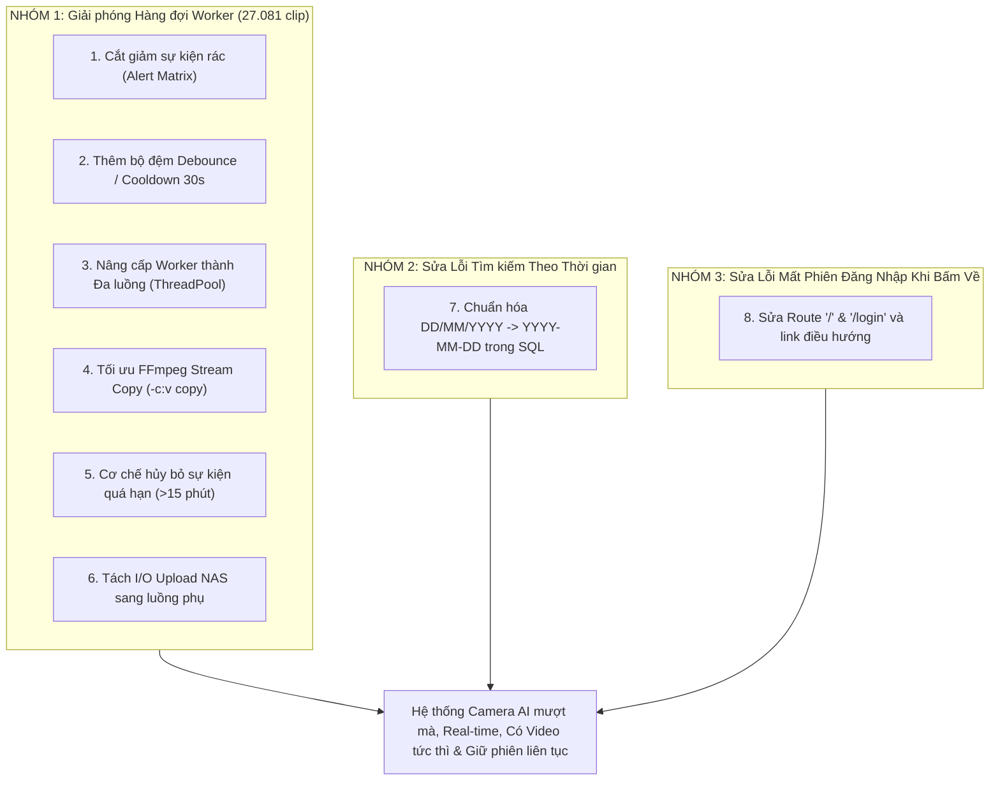

# KẾ HOẠCH TỔNG THỂ XỬ LÝ VÀ TỐI ƯU HỆ THỐNG CAMERA AI DNC

> **Hiện trạng:** Cả 6 tác nhân gây nghẽn hàng đợi và 2 lỗi phát sinh hôm nay **đều chưa được áp dụng vào mã nguồn** (kho lưu trữ Git vẫn đang ở trạng thái sạch ban đầu). Dưới đây là kế hoạch gom toàn bộ thành **1 lần xử lý duy nhất** để khắc phục triệt để và đồng bộ hệ thống.

---

## TỔNG HỢP CÁC HẠNG MỤC CẦN XỬ LÝ (8 VẤN ĐỀ)

---

## CHI TIẾT TỪNG HẠNG MỤC VÀ GIẢI PHÁP CODE

### PHẦN I: XỬ LÝ 6 TÁC NHÂN GÂY NGHẼN HÀNG ĐỢI

#### 1. Lọc ma trận cảnh báo (Loại bỏ sự kiện rác `HumanTrait` / `VideoMotion` ở khu vực đông người)
* **Tệp can thiệp:** `CameraAI/storage/nvr_config.json` & `CameraAI/config.py`.
* **Hiện trạng:** Chỉ có Camera 1 có luật riêng; Camera 18 (Sảnh) sinh ra **12.673 sự kiện người di chuyển/ngày**, toàn bộ bị đẩy vào hàng đợi cắt clip.
* **Giải pháp:** Cập nhật `camera_alert_rules` cho toàn bộ các kênh công cộng (Cam 11 đến 24), chỉ cho phép các mã an ninh nguy hiểm: `Fight`, `Intrusion`, `CrossLine`, `AudioMutation`. Các sự kiện `HumanTrait` ở sảnh vẫn ghi vào Database làm metadata thống kê nhưng **không đưa vào hàng đợi cắt clip**.

#### 2. Thêm cơ chế Debounce / Cooldown trên từng camera
* **Tệp can thiệp:** `CameraAI/dahua_client.py`.
* **Hiện trạng:** Khi 1 người đi qua sảnh, camera phát hiện liên tục 15-20 sự kiện trong 30 giây, đẩy cả 20 yêu cầu cắt clip trùng lặp vào hàng đợi.
* **Giải pháp:** Bổ sung từ điển theo dõi `self._last_clip_queued = {}`. Nếu cùng 1 camera có sự kiện mới cách sự kiện vừa cắt video dưới **30 giây**, chỉ ghi nhận sự kiện vào database và bỏ qua bước enqueue cắt clip.

#### 3. Nâng cấp Worker thành Đa luồng song song (Multi-threaded Worker Pool)
* **Tệp can thiệp:** `CameraAI/clip_capture_worker.py`.
* **Hiện trạng:** Chỉ có **1 Thread duy nhất** xử lý tuần tự, công suất tối đa 7.000 clip/ngày, trong khi đầu vào là 35.000 sự kiện/ngày.
* **Giải pháp:** 
  * Sử dụng `concurrent.futures.ThreadPoolExecutor(max_workers=4)` để có thể tải và xử lý đồng thời 4 camera cùng lúc.
  * Tăng năng lực xử lý từ 7.000 clip/ngày lên **hơn 30.000 clip/ngày**.

#### 4. Tối ưu FFmpeg sang chế độ Stream Copy (`-c:v copy`)
* **Tệp can thiệp:** `CameraAI/video_clipper.py`.
* **Hiện trạng:** FFmpeg decode và re-encode toàn bộ video bằng CPU (`-c:v libx264`), mất từ 10 - 15 giây mỗi clip.
* **Giải pháp:** Đổi sang `-c:v copy` và `-c:a aac`. Video được trích xuất trực tiếp từ luồng H.264 của NVR mà không cần re-encode. Thời gian cắt 1 clip giảm từ **12 giây xuống dưới 0.5 giây** (tăng tốc gấp 25 lần).

#### 5. Cơ chế Xả hàng đợi & Bỏ qua sự kiện cũ (Stale Drop Policy)
* **Tệp can thiệp:** `CameraAI/clip_capture_worker.py`.
* **Hiện trạng:** 27.081 clip cũ từ các ngày trước vẫn nằm trong RAM, khiến sự kiện vừa xảy ra hôm nay phải đứng chờ sau 27.000 clip.
* **Giải pháp:**
  * Thêm logic kiểm tra: Nếu sự kiện xảy ra **quá 15 phút trước** mà Worker chưa kịp xử lý tới ➔ tự động bỏ qua (drop) hoặc gán `status="video_expired"`.
  * Xóa sạch 27.081 task rác đang tồn đọng trong queue để giải phóng ngay lập tức.

#### 6. Tách I/O Upload NAS sang luồng nền độc lập
* **Tệp can thiệp:** `CameraAI/clip_capture_worker.py`.
* **Hiện trạng:** Worker cắt xong clip phải đứng chờ upload qua HTTPS lên Synology NAS xong mới được lấy tiếp clip thứ 2.
* **Giải pháp:** Sau khi FFmpeg tạo xong file cục bộ, cập nhật ngay Database để người dùng xem được liền và AI có file phân tích. Việc gọi `mirror_clip()` lên NAS được đẩy vào background thread riêng.

---

### PHẦN II: XỬ LÝ LỖI TÌM KIẾM THEO KHOẢNG THỜI GIAN

#### 7. Chuẩn hóa định dạng thời gian `DD/MM/YYYY` sang `YYYY-MM-DD` trong SQL
* **Tệp can thiệp:** `CameraAI/vss_search_engine.py` & `CameraAI/templates/search.html`.
* **Hiện trạng:** Giao diện gửi `20/10/2026 12:00`, backend đưa thẳng vào `WHERE timestamp >= '20/10/2026'`, khiến phép so sánh chuỗi SQL luôn trả về `False` (0 kết quả).
* **Giải pháp:**
  1. Trong `vss_search_engine.py`: Bổ sung hàm `normalize_search_time()` để tự động nhận diện và chuyển đổi mọi định dạng ngày (`DD/MM/YYYY`, `DD-MM-YYYY`, ISO) về chuẩn `YYYY-MM-DD HH:MM:SS`.
  2. Trong `search.html`: Đọc trực tiếp giá trị ISO từ input gốc của Flatpickr thay vì đọc chuỗi text hiển thị tiếng Việt trên `altInput`.

---

### PHẦN III: XỬ LÝ LỖI MẤT ĐĂNG NHẬP KHI BẤM QUAY VỀ

#### 8. Sửa Route `/` và `/login` cùng các nút điều hướng
* **Tệp can thiệp:** `CameraAI/main.py`, `quasar-admin/src/layouts/MainLayout.vue`, `quasar-admin/src/pages/DncDashboard.vue`, `quasar-admin/src/config/navigation.js`.
* **Hiện trạng:** 
  * Đường dẫn `/` bị ép cứng chuyển hướng về `/login` (`RedirectResponse(url="/login")`).
  * Trang `/login` không kiểm tra session, khi bị đẩy về `/login` thì hiển thị lại form đăng nhập dù đã đăng nhập rồi.
  * Các nút "Xem Live", "Xem Trực Tiếp", "Về Dashboard" đều gắn link `href="/"`.
* **Giải pháp:**
  1. Sửa route `@app.get("/")` trong `main.py`: Nếu đã có `request.session.get("username")` ➔ tự động chuyển hướng vào `/search` hoặc `/dashboard`.
  2. Sửa route `@app.get("/login")` trong `main.py`: Nếu đã có session ➔ tự động chuyển tiếp vào hệ thống, không hiển thị lại form đăng nhập.
  3. Cập nhật các liên kết `href="/"` trong Quasar Admin thành `href="/dashboard"` hoặc `href="/search"`.

---

## KẾ HOẠCH TRIỂN KHAI THEO CÁC BƯỚC

| Bước | Hạng mục thực hiện | Tệp sửa đổi | Thời gian ước tính |
| :---: | :--- | :--- | :---: |
| **B1** | Sửa triệt để lỗi điều hướng & giữ phiên đăng nhập (Route `/` & `/login`) | `CameraAI/main.py`, `quasar-admin/...` | 5 phút |
| **B2** | Sửa lỗi tìm kiếm theo khoảng thời gian (Normalizer thời gian SQL) | `CameraAI/vss_search_engine.py`, `search.html` | 10 phút |
| **B3** | Tối ưu hóa FFmpeg sang Stream Copy & nâng cấp Worker đa luồng | `video_clipper.py`, `clip_capture_worker.py` | 15 phút |
| **B4** | Thêm Cooldown Debounce 30s & Cắt tỉa sự kiện rác theo ma trận | `dahua_client.py`, `nvr_config.json` | 10 phút |
| **B5** | Xả sạch hàng đợi 27.081 clip rác cũ và chạy thử nghiệm kiểm chứng | `CameraAI/main.py`, restart service | 5 phút |

---

## KẾT QUẢ MỤC TIÊU SAU KHI SỬA
1. **Hàng đợi Worker:** Luôn duy trì ở mức **0 – 10 clip** (thay vì 27.000 clip).
2. **Cảnh báo và Video:** Người dùng bấm vào xem cảnh báo là **có video clip phát ngay lập tức** (độ trễ < 5 giây).
3. **Tìm kiếm theo thời gian:** Nhập bất kỳ khung giờ hoặc khoảng ngày nào đều trả về đầy đủ video sự kiện tương ứng.
4. **Trải nghiệm đăng nhập:** Bấm "Xem Live", quay về trang chủ hay chuyển trang đều giữ nguyên trạng thái đăng nhập, không bao giờ bị đá văng ra màn hình login.

