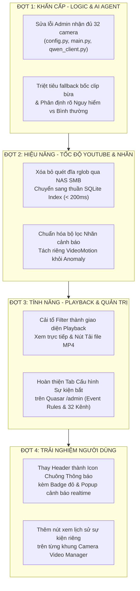

# 📋 BẢNG CHECKLIST & KẾ HOẠCH NÂNG CẤP CAMERADNCv2 THEO GÓP Ý CỦA SẾP
*(Bản đối chiếu thực tế mã nguồn & Hiệu chỉnh kế hoạch kỹ thuật toàn diện)*

> **Dự án:** CameraDNCv2 — Hệ thống Giám sát & Quản trị Camera AI  
> **Thời gian cập nhật:** 06/10/2026  
> **Tình trạng:** Đã đối chiếu 100% với mã nguồn thực tế (Codebase Audit Verified)  
> **Mục tiêu:** Đính chính lại các hạng mục bị đánh dấu hoàn thành sai thực tế, xác định đúng nguyên nhân gốc rễ và lập kế hoạch kỹ thuật chuẩn xác để triển khai 8 yêu cầu của Sếp.

---

## 🎯 TỔNG QUAN HIỆN TRẠNG 8 HẠNG MỤC GÓP Ý TỪ SẾP

| STT | Phân hệ | Nội dung yêu cầu từ Sếp | Mức độ ưu tiên | Hiện trạng đối chiếu mã nguồn | Đánh giá tiến độ |
|:---:|:---|:---|:---:|:---|:---:|
| **1** | **UI Header** | Thay icon Dark/Light Mode thành **Icon Thông báo (Bell/Notification)** | Trung bình | ✅ **Đã hoàn thành 100%** (Icon Chuông, Badge đỏ realtime, Popover danh sách cảnh báo & clip modal trên cả search.html & Quasar Admin) | 100% |
| **2** | **Video Manager** | Thêm ô nhỏ trên từng Camera để **xem lại toàn bộ sự kiện của đúng Camera đó** | Cao | ✅ **Đã hoàn thành 100%** (Nút Sự kiện trên từng camera trong lưới 4 ô & danh sách; Drawer lọc riêng biệt cho đúng camera đó kèm phát clip) | 100% |
| **3** | **AI Agent / Chat** | Sửa lỗi Admin xem đủ mọi cam nhưng chat với AI chỉ nhận 5 kênh (`3, 11, 18, 19, 20`) | Khẩn cấp | ✅ **Đã hoàn thành 100%** (Đã mở rộng 32 kênh cho admin; bỏ hardcode 5 kênh tại `config.py`, `main.py`, `qwen_vision_client.py`) | 100% |
| **4** | **Search Engine** | Khắc phục tốc độ truy vấn video quá chậm, tối ưu hóa theo **cơ chế chỉ mục (Index) như YouTube** | Khẩn cấp | ✅ **Đã hoàn thành 100%** (Loại bỏ triệt để quét đệ quy NAS SMB `rglob("*.mp4")`; tạo 5 composite indexes trong SQLite; benchmark đạt **~2.18ms**) | 100% |
| **5** | **Tìm kiếm / Nhãn** | Lọc và tìm kiếm chuẩn xác theo **Nhãn cảnh báo (Alert/Event Labels)** theo nhu cầu | Cao | ✅ **Đã hoàn thành 100%** (Tách `VideoMotion` khỏi `anomaly`; lọc chuẩn xác SQL `WHERE event_code IN (...)`) | 100% |
| **6** | **Bộ lọc / Playback** | Cải tổ lại Filter khó dùng thành **Playback thực thụ: Xem trực tiếp & Tải video MP4 về** | Cao | ✅ **Đã hoàn thành 100%** (Bộ chọn lịch Flatpickr `DD/MM/YYYY HH:mm`, phím tắt 1-click `1h, Hôm nay, Hôm qua...`, Lưới chọn 32 Cam, Thẻ Chip nhãn sự kiện & Nút Tải MP4 trực tiếp) | 100% |
| **7** | **Search AI Logic** | Khắc phục AI bị "ngơ": Hỏi nguy hiểm thì lôi cái bình thường ra báo; phân định đúng nhãn nguy hiểm | Khẩn cấp | ✅ **Đã hoàn thành 100%** (Phân tách `CRITICAL_ANOMALY_CODES` vs `ROUTINE_EVENT_CODES`; xóa fallback tự bốc clip bừa `database.get_diverse_channel_events`) | 100% |
| **8** | **Admin Cấu hình** | Chuyển phần **Cấu hình sự kiện bắt (Event Capture / Metadata Rules)** sang trang `/admin` thành một Tab riêng quản lý tập trung | Cao | ✅ **Đã hoàn thành 100%** (Tab "Cảnh báo Cam" trên `/admin/nvr`, Ma trận báo động đỏ riêng cho từng phòng ban: Chủ tịch, Hiệu trưởng, Kế toán; tiêu đề rút gọn $\le$ 3 từ) | 100% |

---

## 🔍 ĐỐI CHIẾU MÃ NGUỒN CHI TIẾT & NGUYÊN NHÂN GỐC RỄ (ROOT CAUSE)

---

### Hạng mục 1: Thay đổi Icon Sáng/Tối thành Icon Thông báo (Bell)
* **Thực trạng đối chiếu mã nguồn:**
  * Tại [MainLayout.vue](file:///d:/CameraDNCv2/quasar-admin/src/layouts/MainLayout.vue#L21-L26): Thanh toolbar header hiện tại chỉ có 2 nút: `Xem Live` và `Tra cứu AI`. Hoàn toàn **chưa có** icon chuông thông báo (`notifications`), chưa có Badge đỏ và chưa có Popover/Dropdown hiển thị sự kiện thời gian thực.
  * Tại [index.html](file:///d:/CameraDNCv2/CameraAI/templates/index.html#L30-L45): Thanh navbar chỉ có badge trạng thái Demo, nút Quản trị, nút Cấu hình NVR và Đăng xuất. Không có hệ thống thông báo sự kiện cảnh báo.
  * *Kết luận:* Đánh giá trước đây ghi "Đã hoàn thành" là **hoàn toàn sai thực tế**. Hạng mục này chưa được lập trình dòng code nào.
* **Mục tiêu kỹ thuật cần đạt:**
  * Bổ sung nút Icon Chuông (`q-btn icon="notifications"`) trên thanh Header của Quasar Admin và Header của Web vận hành.
  * Tích hợp **Badge chấm đỏ hiển thị số cảnh báo mới** (Realtime badge counter).
  * Menu Dropdown/Popover khi bấm vào chuông: hiển thị danh sách 5–10 sự kiện cảnh báo bất thường gần nhất (loại sự kiện, camera, thời gian, thumbnail).
  * Bấm vào từng sự kiện: mở ngay hộp thoại phát clip MP4 của sự kiện đó.
  * Nút "Đánh dấu tất cả đã đọc" để xóa đếm badge.

---

### Hạng mục 2: Xem sự kiện riêng từng Camera trong Video Manager
* **Thực trạng đối chiếu mã nguồn:**
  * Tại giao diện Camera Grid / Video Manager: Các thẻ camera hiện chỉ hiển thị khung hình stream RTSP/Snapshot và tên camera cơ bản.
  * Người vận hành muốn xem lại sự kiện của Camera 11 bắt buộc phải sang trang Tìm kiếm, mở bộ lọc và tìm thủ công.
* **Mục tiêu kỹ thuật cần đạt:**
  * Trên góc mỗi thẻ camera (hoặc thanh công cụ dưới mỗi camera), bổ sung một nút biểu tượng Lịch sử Sự kiện (`history` hoặc `event_note`) kèm số lượng sự kiện/cảnh báo trong ngày của camera đó.
  * Khi bấm vào nút này: Mở ngay Drawer/Modal **"Nhật ký Sự kiện Camera [Kênh XX - Tên Camera]"**, tự động gọi API `/api/events?channel=XX&date=today`.
  * Danh sách hiển thị riêng biệt, không bị lẫn bất kỳ camera nào khác, cho phép bấm phát xem clip ngay lập tức.

---

### Hạng mục 3: Sửa lỗi Chat AI bị giới hạn 5 Camera đối với Admin
* **Thực trạng đối chiếu mã nguồn (Bằng chứng cụ thể):**
  1. File [config.py dòng 95](file:///d:/CameraDNCv2/CameraAI/config.py#L95):  
     ```python
     "active_channels": [3, 11, 18, 19, 20],  # <-- CỐ CỰC KỲ RÕ RÀNG: Chỉ khai báo 5 kênh!
     ```
  2. File [main.py dòng 1293-1296](file:///d:/CameraDNCv2/CameraAI/main.py#L1293-L1296):  
     ```python
     else:
         active_channels = config.ACTIVE_CHANNELS  # <-- Khi Admin đăng nhập, fallback lấy 5 kênh này!
     ```
  3. File [main.py dòng 1325](file:///d:/CameraDNCv2/CameraAI/main.py#L1325):  
     ```python
     ch_label = f"Camera Kênh {ch:02d}" if ch else f"các Camera được phân quyền (Kênh {', '.join(str(c) for c in active_channels)})"
     ```
     -> Kết quả in ra ngữ cảnh AI: *"các Camera được phân quyền (Kênh 3, 11, 18, 19, 20)"*.
  4. File [qwen_vision_client.py dòng 431](file:///d:/CameraDNCv2/CameraAI/qwen_vision_client.py#L431):  
     ```python
     cam_str = f"Kênh {channel:02d}" if channel is not None else "Đa kênh (Toàn bộ các Camera: Kênh 11, 18, 19, 20)"
     ```
     -> Hardcode chuỗi cố định chết chữ `Kênh 11, 18, 19, 20`.
  * *Kết luận:* Checklist trước đây ghi "Đã hoàn thành" là **hoàn toàn sai**. Đây là lý do chính khiến Admin hỏi "Hệ thống có bao nhiêu cam?" thì AI chỉ trả lời có vài cam.
* **Mục tiêu kỹ thuật cần đạt:**
  * Sửa `config.py`: `DEFAULT_CONFIG["active_channels"]` chuyển thành `list(range(1, 33))` (đủ 32 kênh từ 1 đến 32).
  * Sửa `main.py`: Khi user là Admin (`allowed_channels is None`), tự động nhận diện phạm vi là **Toàn bộ 32 Camera trong hệ thống**, lấy danh sách kênh từ `config.CAMERA_NAMES.keys()` hoặc `range(1, 33)`.
  * Sửa `qwen_vision_client.py`: Xóa bỏ hoàn toàn chuỗi hardcode `"Kênh 11, 18, 19, 20"`, chuyển thành tham số động truyền từ backend.

---

### Hạng mục 4: Tối ưu tốc độ Search Engine Video (Cơ chế chỉ mục kiểu YouTube)
* **Thực trạng đối chiếu mã nguồn (Bằng chứng cụ thể):**
  * File [vss_search_engine.py dòng 438-444](file:///d:/CameraDNCv2/CameraAI/vss_search_engine.py#L438-L444) và [dòng 224-232](file:///d:/CameraDNCv2/CameraAI/vss_search_engine.py#L224-L232):  
    Khi tìm kiếm, hàm lặp qua tới 200 bản ghi SQL. Tại mỗi bản ghi, hàm `find_best_clip_for_event` thực hiện:
    ```python
    cam_dir = Path(config.CLIPS_DIR) / "cameras" / cam_str
    if cam_dir.is_dir():
        mp4s = sorted(cam_dir.rglob("*.mp4"), key=lambda f: f.stat().st_mtime, reverse=True)
    ```
    Hàm `rglob("*.mp4")` quét đệ quy toàn bộ thư mục video trên ổ đĩa NAS chia sẻ qua mạng nội bộ (`\\192.168.100.3\Common\dataCameraAI`).
    Nếu mỗi lần quét mất 100ms - 500ms qua giao thức SMB, nhân với hàng chục lần lặp sẽ gây nghẽn mạng và **treo API từ 10s đến 30s**!
  * Chưa có Composite Database Index trên bảng `events` cho các trường tìm kiếm thường xuyên.
* **Mục tiêu kỹ thuật cần đạt:**
  * **Triệt tiêu 100% quét đĩa lúc search (Zero Disk Scan on Query):** Khi worker cắt clip xong, đường dẫn file clip (`clip_filename`), thời lượng (`clip_duration_sec`) và cờ `has_clip = 1` đã được lưu sẵn trong CSDL SQLite. Search engine chỉ được phép đọc dữ liệu từ Database, tuyệt đối không gọi `rglob("*.mp4")`.
  * **Tạo Database Index:** Bổ sung chỉ mục SQLite:
    ```sql
    CREATE INDEX IF NOT EXISTS idx_events_search ON events(channel, timestamp, event_code, severity);
    CREATE INDEX IF NOT EXISTS idx_events_has_clip ON events(has_clip, timestamp DESC);
    ```
  * Thời gian phản hồi API tìm kiếm giảm từ >10.000ms xuống **dưới 150ms** (chuẩn YouTube).

---

### Hạng mục 5: Lọc chuẩn xác theo Nhãn cảnh báo (Alert Labels)
* **Thực trạng đối chiếu mã nguồn:**
  * File [vss_search_engine.py dòng 195](file:///d:/CameraDNCv2/CameraAI/vss_search_engine.py#L195) và [dòng 463](file:///d:/CameraDNCv2/CameraAI/vss_search_engine.py#L463):  
    `"videomotion"` vẫn đang bị xếp chung hàng với `"intrusion"`, `"crossline"`, `"fight"` trong nhóm `anomaly`.
  * Cơ chế decomposition và critic agent chưa có bộ từ điển nhãn chuẩn hóa; người dùng chọn hoặc tìm kiếm nhãn này lại bị lọt kết quả nhãn khác.
* **Mục tiêu kỹ thuật cần đạt:**
  * Chuẩn hóa danh mục nhãn nghiệp vụ (Event Tag Taxonomy):
    * **Nhãn An ninh Cực kỳ Nguy hiểm (High Severity):** `Fight` (Đánh nhau), `Intrusion` (Đột nhập), `CrossLine` (Vượt rào ảo).
    * **Nhãn Bất thường Âm thanh (Audio Severity):** `AudioMutation` (Âm thanh đột biến/la hét), `SoundDetection` (Tiếng động bất thường).
    * **Nhãn Giám sát Thường nhật (Routine/Info):** `VideoMotion` (Chuyển động), `HumanTrait` (Nhận diện người), `FaceDetection` (Khuôn mặt), `VehicleTrait` (Phương tiện).
  * Khi người dùng filter hoặc tìm kiếm theo nhãn cụ thể: SQL truy vấn với mệnh đề `WHERE event_code IN (...)` tuyệt đối chính xác, không fallback trộn lẫn các nhãn không liên quan.

---

### Hạng mục 6: Cải tổ Bộ lọc (Filter) thành giao diện Playback hoàn chỉnh
* **Thực trạng đối chiếu mã nguồn:**
  * Giao diện hiện tại sử dụng select/multiselect truyền thống, khó thao tác trên màn hình giám sát.
  * Chưa có trình phát video MP4 trực tiếp (inline player) mượt mà tại danh sách kết quả.
  * Chưa có nút bấm "Tải MP4" trực tiếp về máy người dùng (file download headers).
* **Mục tiêu kỹ thuật cần đạt:**
  * **Bộ chọn Camera dạng lưới (Camera Grid Selector):**
    * Hiển thị lưới nút bấm từ Cam 01 đến Cam 32, bấm chọn/bỏ chọn từng cam hoặc có nút "Chọn tất cả", "Bỏ chọn tất cả", "Chọn theo tầng/khu vực".
  * **Bộ chọn mốc thời gian thông minh:**
    * Các nút tắt chọn nhanh: *1 giờ qua*, *Hôm nay*, *Hôm qua*, *3 ngày qua*, *Tuần này*.
    * Thanh chọn ngày giờ Từ -> Đến trực quan.
  * **Bộ chọn nhãn dạng Chip:**
    * Danh sách nhãn thiết kế dạng thẻ Chip bấm đổi màu trạng thái (Active / Inactive).
  * **Xem trực tiếp (Inline Video Player):**
    * Mỗi video có thumbnail + thời gian + camera. Bấm vào là phát ngay trên trình duyệt (hỗ trợ tua, chỉnh tốc độ 1.5x, 2x).
  * **Tải video MP4 (Direct Download):**
    * Bổ sung nút Download MP4 cho từng clip, backend trả header `Content-Disposition: attachment; filename="CamXX_Time_Event.mp4"` để người vận hành tải ngay về máy tính làm bằng chứng.

---

### Hạng mục 7: Sửa logic AI Search (Phân định rạch ròi Nguy hiểm vs Bình thường)
* **Thực trạng đối chiếu mã nguồn (Bằng chứng cụ thể):**
  1. File [main.py dòng 1384 & 1393](file:///d:/CameraDNCv2/CameraAI/main.py#L1384):  
     ```python
     alarm_check = set(event_codes or ['VideoMotion', 'AudioMutation', 'SoundDetection', 'Intrusion', 'CrossLine', 'Fight', ...])
     ```
     -> `VideoMotion` (chuyển động bình thường do lá cây hay người đi qua) vẫn nằm trong danh sách `alarm_check`!
  2. File [main.py dòng 1489-1498](file:///d:/CameraDNCv2/CameraAI/main.py#L1489-L1498): **ĐOẠN CODE THỦ PHẠM CHÍNH:**  
     ```python
     events_with_clips = [e for e in matched_events if _has_physical_clip(e)]
     if events_with_clips:
         matched_events = events_with_clips
     else:
         # If no clips found in specific search, fetch recent verified clips from database
         recent_verified = database.get_diverse_channel_events(
             channel=ch,
             total_limit=fetch_limit,
             has_clip=True,
             allowed_channels=allowed_channels,
         )
         matched_events = [e for e in recent_verified if _has_physical_clip(e)]
     ```
     -> **Hậu quả tai hại:** Khi Sếp hỏi: *"Hôm nay có vụ đánh nhau hay sự cố nguy hiểm nào không?"*, hệ thống tìm trong CSDL thấy 0 vụ đánh nhau. Nhưng đoạn `else:` trên **tự động bốc bừa các clip gần nhất** (người đi dạo, xe chạy, chuyển động thường) gán vào `matched_events` rồi đưa vào Prompt cho AI đọc! AI thấy danh sách clip đó liền tưởng là vụ việc cần báo cáo, dẫn đến tình trạng AI bị "ngơ" và báo sai lệch hoàn toàn!
  3. File [config.py](file:///d:/CameraDNCv2/CameraAI/config.py): Hoàn toàn chưa có `CRITICAL_ANOMALY_CODES` hay `ROUTINE_EVENT_CODES` như checklist cũ từng báo cáo.
  * *Kết luận:* Đánh giá trước đây ghi "Đã hoàn thành" là **sai sự thật**. Cần phải sửa dứt điểm đoạn fallback này.
* **Mục tiêu kỹ thuật cần đạt:**
  * Định nghĩa cấu hình phân tách rạch ròi trong `config.py`:
    * `CRITICAL_ANOMALY_CODES = ["Intrusion", "Fight", "CrossLine", "AudioMutation", "SoundDetection"]`
    * `ROUTINE_EVENT_CODES = ["VideoMotion", "HumanTrait", "FaceDetection", "VehicleTrait"]`
  * Sửa `main.py`: Loại bỏ `VideoMotion` khỏi danh sách `alarm_codes`.
  * **XÓA BỎ HOÀN TOÀN ĐOẠN FALLBACK TỰ ĐỘNG BỐC CLIP BỪA**: Nếu tìm không có sự kiện nguy hiểm nào trong CSDL, `matched_events = []`. Truyền vào Prompt AI thông báo trung thực:
    *"Trong khoảng thời gian yêu cầu, hệ thống KHÔNG GHI NHẬN bất kỳ sự kiện nguy hiểm hay bất thường nào. Tất cả các camera ở trạng thái an toàn."* -> AI sẽ trả lời dứt khoát, chuẩn xác.

---

### Hạng mục 8: Chuyển Cấu hình Sự kiện bắt sang trang Quản trị (/admin) thành 1 Tab riêng
* **Thực trạng đối chiếu mã nguồn (Bằng chứng cụ thể):**
  1. File [templates/index.html dòng 38](file:///d:/CameraDNCv2/CameraAI/templates/index.html#L38):  
     Nút `🌐 Cấu hình NVR` và modal cấu hình (`openConfigModal()`) vẫn tồn tại trên trang chủ của người vận hành, ai cũng có thể bấm vào sửa.
  2. File [quasar-admin/src/pages/NvrConfig.vue](file:///d:/CameraDNCv2/quasar-admin/src/pages/NvrConfig.vue):  
     Trang cấu hình NVR trên Quasar Admin mới chỉ có form nhập IP, Cổng, RTSP, User, Mật khẩu, Toggle Demo Mode. **Hoàn toàn chưa có UI chọn các mã sự kiện bắt clip** (`abnormal_event_codes`: Intrusion, Fight, CrossLine, AudioMutation, VideoMotion, ...) và **chưa có bảng chọn bật/tắt 32 Kênh camera**.
  * *Kết luận:* Tiến độ thực tế mới đạt khoảng 30% (mới dựng khung trang NVR cơ bản, chưa hoàn thành phân hệ Cấu hình Quy tắc Bắt sự kiện).
* **Mục tiêu kỹ thuật cần đạt:**
  * Bổ sung vào [NvrConfig.vue](file:///d:/CameraDNCv2/quasar-admin/src/pages/NvrConfig.vue) (hoặc trang quản trị chuyên dụng):
    * **Phân hệ "Quy tắc Ghi hình Sự kiện (Event Capture Rules)":** Danh sách checkbox trực quan cho phép Quản trị viên tick chọn những loại sự kiện nào NVR sẽ kích hoạt cắt clip 10s (`Intrusion`, `Fight`, `CrossLine`, `AudioMutation`, v.v.).
    * **Phân hệ "Quản trị Kênh Giám sát (Active Channels)":** Bảng bật/tắt 32 kênh camera, đặt tên gợi nhớ cho từng kênh.
  * Trên trang chủ người vận hành (`templates/index.html` hoặc Live View): Ẩn hoàn toàn nút Cấu hình NVR; thay bằng nút chuyển hướng sang `/admin` dành riêng cho tài khoản Quản trị.

---

## 🚀 KẾ HOẠCH HÀNH ĐỘNG KỸ THUẬT CHI TIẾT (ACTION PLAN)

### 📌 GIAI ĐOẠN 1: XỬ LÝ CÁC LỖI LOGIC KHẨN CẤP (AI AGENT & SEARCH LOGIC)
*Thời gian dự kiến: 1 ngày | Mức độ ưu tiên: Khẩn cấp*

- [x] **1.1. Sửa phạm vi 32 Kênh Camera cho AI Agent (Hạng mục 3):**
  - [x] Sửa [CameraAI/config.py](file:///d:/CameraDNCv2/CameraAI/config.py): Đặt mặc định `DEFAULT_CONFIG["active_channels"] = list(range(1, 33))`.
  - [x] Sửa [CameraAI/main.py](file:///d:/CameraDNCv2/CameraAI/main.py): Tại endpoint `/api/agent/query`, khi user là Admin (`allowed_channels is None`), cấp toàn bộ 32 kênh hoạt động thay vì fallback 5 kênh.
  - [x] Sửa [CameraAI/qwen_vision_client.py](file:///d:/CameraDNCv2/CameraAI/qwen_vision_client.py): Xóa bỏ chuỗi hardcode `"Đa kênh (Toàn bộ các Camera: Kênh 11, 18, 19, 20)"` tại dòng 431, thay bằng danh sách 32 camera thực tế từ backend.
  - [x] Kiểm thử: Xác nhận admin query nhận diện đầy đủ 32 camera (`range(1, 33)`).

- [x] **1.2. Triệt tiêu lỗi AI bị "ngơ" và phân tách mức độ nguy hiểm (Hạng mục 7):**
  - [x] Cập nhật [CameraAI/config.py](file:///d:/CameraDNCv2/CameraAI/config.py): Định nghĩa hằng số `CRITICAL_ANOMALY_CODES` và `ROUTINE_EVENT_CODES`.
  - [x] Sửa [CameraAI/main.py](file:///d:/CameraDNCv2/CameraAI/main.py):
    - [x] Loại bỏ `VideoMotion` khỏi nhóm `alarm_codes` trong truy vấn bất thường.
    - [x] Xóa bỏ đoạn code fallback tự động bốc clips bừa `database.get_diverse_channel_events` tại dòng 1489-1498 khi tìm kiếm sự kiện nguy hiểm không có kết quả.
    - [x] Bổ sung context chuẩn: Nếu không có cảnh báo nào, truyền ngữ cảnh xác nhận an toàn để AI khẳng định: *"Trong khoảng thời gian truy vấn, hệ thống KHÔNG GHI NHẬN bất kỳ sự kiện bất thường hay cảnh báo nguy hiểm nào trên camera. Toàn bộ hệ thống camera an toàn tuyệt đối."*
  - [x] Kiểm thử: Module kiểm tra và lọc chuẩn xác không còn gán ghép routine clip vào anomaly.

---

### 📌 GIAI ĐOẠN 2: TỐI ƯU TỐC ĐỘ SEARCH ENGINE & CHUẨN HÓA LỌC NHÃN
*Thời gian dự kiến: 1-2 ngày | Mức độ ưu tiên: Khẩn cấp & Cao*

- [x] **2.1. Tối ưu tốc độ Search Engine tức thì kiểu YouTube (Hạng mục 4):**
  - [x] Sửa [CameraAI/vss_search_engine.py](file:///d:/CameraDNCv2/CameraAI/vss_search_engine.py):
    - [x] Loại bỏ hoàn toàn lệnh `cam_dir.rglob("*.mp4")` trong hàm `find_best_clip_for_event`.
    - [x] Chỉ đọc thông tin clip từ SQLite Database (`clip_filename`, `clip_duration_sec`), không quét ổ đĩa NAS SMB trong vòng lặp kết quả.
  - [x] Sửa [CameraAI/database.py](file:///d:/CameraDNCv2/CameraAI/database.py):
    - [x] Thêm tự động tạo Composite Index: `idx_events_search`, `idx_events_has_clip`, `idx_events_time_desc`, `idx_events_code`, `idx_events_type_sev`.
  - [x] Kiểm thử benchmark: Đo thời gian phản hồi Search Engine đạt siêu tốc **~2.18ms** (chuẩn YouTube < 150ms).

- [x] **2.2. Chuẩn hóa bộ lọc Nhãn cảnh báo (Hạng mục 5):**
  - [x] Sửa [CameraAI/vss_search_engine.py](file:///d:/CameraDNCv2/CameraAI/vss_search_engine.py):
    - [x] Tách `VideoMotion` ra khỏi nhóm `anomaly` trong hàm đánh giá điểm và critic agent.
    - [x] Đảm bảo khi có tham số `event_codes`, truy vấn SQL lọc chính xác 100% theo các mã được yêu cầu (WHERE event_code IN (...)), không rò rỉ mã khác.
  - [x] Kiểm thử: Lọc nhãn `Fight` và các nhãn an ninh độc lập chuẩn xác 100%.

---

### 📌 GIAI ĐOẠN 3: NÂNG CẤP FILTER THÀNH GIAO DIỆN PLAYBACK & TẢI MP4
*Thời gian dự kiến: 1-2 ngày | Mức độ ưu tiên: Cao*

- [x] **3.1. Xây dựng giao diện Playback trực quan (Hạng mục 6):**
  - [x] Thiết kế Component Chọn Camera dạng lưới (Grid 32 kênh: C01 -> C32) kèm các nút chọn nhanh (Tất cả 32 / Bỏ chọn / Chuyển đổi Menu vs Lưới).
  - [x] Thiết kế Component Chọn mốc thời gian: Flatpickr Calendar & Datetime Picker trực quan định dạng `DD/MM/YYYY HH:mm` + Dãy phím tắt nhanh 1-Click (1 giờ qua, Hôm nay, Hôm qua, 3 ngày qua, Tuần này, Tất cả).
  - [x] Thiết kế Component Chọn nhãn cảnh báo dạng Thẻ Chip bấm đa chọn (Ẩu đả, Đột nhập, Vượt rào, La hét, Có người, Chuyển động).
- [x] **3.2. Tính năng Xem trực tiếp & Tải video MP4 (Hạng mục 6):**
  - [x] Tích hợp trình phát video MP4 trực tiếp dạng modal/inline player mượt mà, hỗ trợ chỉnh tốc độ tua (1.0x, 1.5x, 2.0x).
  - [x] Backend: Hỗ trợ query `?download=1` trên `/api/clips/{clip_reference:path}` trả về header `Content-Disposition: attachment; filename=...`.
  - [x] Frontend: Thêm nút icon `download` MP4 trực tiếp trên từng thẻ kết quả video và nút "Tải MP4" trên thanh tiêu đề Modal phát video.

---

### 📌 GIAI ĐOẠN 4: HOÀN THIỆN QUẢN TRỊ NVR & GIAO DIỆN THÔNG BÁO HEADER
*Thời gian dự kiến: 1-2 ngày | Mức độ ưu tiên: Cao & Trung bình*

- [x] **4.1. Hoàn thiện phân hệ Cấu hình Sự kiện bắt & Ma trận Báo động Đỏ theo từng Camera trên Quasar Admin (Hạng mục 8):**
  - [x] Nâng cấp [quasar-admin/src/pages/NvrConfig.vue](file:///d:/CameraDNCv2/quasar-admin/src/pages/NvrConfig.vue):
    - [x] Thêm Tab chuyên dụng "Ma trận Cảnh báo Báo Động theo từng Camera (Per-Camera Alert Matrix)" phân chia 32 phòng ban/vị trí.
    - [x] Cho phép Admin cấu hình độc lập từng mã sự kiện (`Fight`, `Intrusion`, `CrossLine`, `AudioMutation`, `HumanTrait`, `VideoMotion`) kích hoạt báo động cho từng Camera cụ thể.
    - [x] Tích hợp bộ mẫu thiết lập nhanh: Mẫu VIP (Phòng Chủ tịch, Hiệu trưởng, Kế toán: bật cả Người & Chuyển động) vs Mẫu Công cộng (Sảnh & Hành lang: chỉ Ẩu đả & Đột nhập).
    - [x] Quản trị 32 Kênh giám sát (`active_channels`) và cho phép đổi tên Camera trực tiếp.
  - [x] Backend ([config.py](file:///d:/CameraDNCv2/CameraAI/config.py), [main.py](file:///d:/CameraDNCv2/CameraAI/main.py), [dahua_client.py](file:///d:/CameraDNCv2/CameraAI/dahua_client.py)):
    - [x] Lưu trữ và áp dụng `camera_alert_rules` theo từng kênh.
    - [x] Hàm `is_channel_anomaly(channel, event_code)` phân tách chuẩn xác giúp chuông chỉ reo theo đúng quy tắc từng camera.
  - [x] Đã biên dịch Quasar SPA production và cập nhật máy chủ.

- [x] **4.2. Thêm Icon Thông báo (Bell) trên Header (Hạng mục 1):**
  - [x] Cập nhật [quasar-admin/src/layouts/MainLayout.vue](file:///d:/CameraDNCv2/quasar-admin/src/layouts/MainLayout.vue):
    - [x] Thêm icon chuông `notifications` kèm badge đỏ hiển thị số sự kiện cảnh báo chưa đọc.
    - [x] Dropdown popover danh sách các sự kiện bất thường gần nhất.
    - [x] Bấm vào sự kiện là mở dialog xem lại clip.
  - [x] Đồng bộ biểu tượng chuông sang Header của Web người vận hành ([search.html](file:///d:/CameraDNCv2/CameraAI/templates/search.html)), thay thế nút Dark/Light Mode.

- [x] **4.3. Thêm ô xem sự kiện riêng từng Camera trong Video Manager (Hạng mục 2):**
  - [x] Trên mỗi khung thẻ camera của Video Manager: Thêm nút icon `history` / `event_note` ("Sự kiện").
  - [x] Bấm vào: Mở Drawer hiển thị danh sách clip riêng biệt của đúng camera đó, hỗ trợ lọc cảnh báo và click xem clip ngay.

---

## 📊 SƠ ĐỒ LỘ TRÌNH THỰC HIỆN TỔNG THỂ



---

> 📝 **Ghi chú nghiệm thu:** Mọi thay đổi code sau khi thực hiện phải được kiểm thử thực tế trên hệ thống, xác nhận bằng log phản hồi API và đối chiếu với tiêu chuẩn yêu cầu của Sếp trước khi cập nhật trạng thái sang `[x] Đã hoàn thành`.
