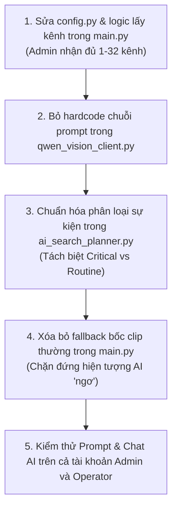

# KẾ HOẠCH TRIỂN KHAI 1: TỐI ƯU HÓA AI AGENT & SEARCH INTELLIGENCE

> **Liên kết Checklist:** Hạng mục 3 (Chat AI Admin nhận đủ 32 camera) & Hạng mục 7 (Sửa AI bị "ngơ", phân định đúng sự kiện Nguy hiểm)  
> **Dự án:** CameraDNCv2  
> **Tệp tác động chính:** `CameraAI/main.py`, `CameraAI/qwen_vision_client.py`, `CameraAI/ai_search_planner.py`, `CameraAI/config.py`  

---

## 1. MỤC TIÊU
1. **Khắc phục lỗi bó hẹp kênh:** Tài khoản Admin có quyền xem tất cả camera (kênh 1 đến 32), AI phải tự động nhận diện đầy đủ toàn bộ camera thực tế thay vì bị giới hạn ở 5 kênh (`3, 11, 18, 19, 20`).
2. **Loại bỏ hiện tượng AI "ngơ":**
   - Phân biệt tuyệt đối giữa **Nguy hiểm / Cảnh báo an ninh thực sự** (Đột nhập, Đánh nhau, Vượt rào, Âm thanh lớn bất thường) với **Hoạt động bình thường** (Chuyển động gió/lá cây, người/xe đi lại thông thường).
   - Khi sếp hỏi về sự kiện nguy hiểm: Chỉ trả về sự kiện nguy hiểm thực sự. Nếu không có, AI phải báo cáo trung thực là *"Hệ thống không ghi nhận sự kiện nguy hiểm nào"*, **tuyệt đối không được bốc video bình thường ra thay thế**.

---

## 2. NGUYÊN NHÂN KỸ THUẬT & GIẢI PHÁP

### 2.1. Lỗi bó hẹp 5 kênh (Admin bị ép kênh)
* **Nguyên nhân:**
  * `CameraAI/config.py`: Cấu hình mặc định `"active_channels": [3, 11, 18, 19, 20]`.
  * `CameraAI/main.py`: Đoạn code xử lý `allowed_channels` lấy phép giao `intersection(set(config.ACTIVE_CHANNELS))` khiến danh sách kênh của Admin bị thu hẹp lại đúng 5 kênh này.
  * `CameraAI/qwen_vision_client.py` dòng 431: Chuỗi prompt gán cứng: `"Đa kênh (Toàn bộ các Camera: Kênh 11, 18, 19, 20)"`.
* **Giải pháp:**
  * Sửa logic lấy kênh: Nếu người dùng là Admin hoặc có toàn quyền (`allowed_channels is None` hoặc đủ 1..32), nạp toàn bộ danh sách camera thực tế (1 đến 32 hoặc các camera đang online/có trong DB).
  * Xóa hoàn toàn chuỗi hardcode trong prompt của `qwen_vision_client.py`, thay bằng biến động `cam_str` dựa trên danh sách kênh thực tế của phiên truy cập.

### 2.2. Lỗi AI lấy sự kiện bình thường khi hỏi nguy hiểm
* **Nguyên nhân:**
  * `ai_search_planner.py`: Xếp `VideoMotion` vào `ANOMALY_CODES`. Khi camera Dahua liên tục gửi mã `VideoMotion` (người đi lại, lá cây rung), hệ thống coi đó là bất thường nguy hiểm.
  * `main.py` (dòng 1486-1498): Khi tìm sự kiện nguy hiểm mà chưa có file MP4 vật lý trên đĩa, đoạn mã fallback tự động gọi `database.get_diverse_channel_events()` bốc các clip bình thường (`HumanTrait`) nạp vào ngữ cảnh của AI. AI đọc ngữ cảnh thấy toàn clip bình thường nên trả lời sếp về các clip đó!
* **Giải pháp:**
  * Phân tách 2 cấp độ cảnh báo rõ ràng:
    * **High Severity / Critical Anomalies:** `Intrusion`, `CrossLine`, `Fight`, `AudioMutation` (vượt ngưỡng âm thanh lớn > 80dB), `SoundDetection`.
    * **Routine Metadata / Normal Activity:** `VideoMotion`, `HumanTrait`, `FaceDetection`, `VehicleTrait`.
  * **Triệt tiêu Fallback sai:** Khi người dùng tìm kiếm theo ý định "nguy hiểm", nếu CSDL không có clip nguy hiểm nào thì `matched_events = []`, context ghi rõ: *"Không có sự kiện nguy hiểm/bất thường nào trong khoảng thời gian được truy vấn"*. Tuyệt đối không gọi fallback bốc sự kiện thường.

---

## 3. CÁC BƯỚC THỰC HIỆN CHI TIẾT



### Bước 1: Sửa logic kênh tại `CameraAI/main.py`
```python
# Thay vì lấy intersection với config.ACTIVE_CHANNELS nếu admin có toàn quyền:
if allowed_channels is None:
    # Admin có toàn quyền -> Lấy toàn bộ 32 kênh hoặc các kênh có trong hệ thống
    active_channels = list(range(1, 33))
else:
    active_channels = allowed_channels
```

### Bước 2: Sửa prompt động trong `CameraAI/qwen_vision_client.py`
```python
# Thay thế dòng 431:
if channel is not None:
    cam_str = f"Camera Kênh {channel:02d}"
else:
    channels_display = ", ".join(f"Kênh {c:02d}" for c in sorted(active_channels))
    cam_str = f"Toàn bộ các Camera được giám sát ({channels_display})"
```

### Bước 3: Chuẩn hóa `ANOMALY_CODES` trong `CameraAI/ai_search_planner.py`
```python
CRITICAL_ANOMALIES = [
    "Intrusion",
    "CrossLine",
    "Fight",
    "AudioMutation",
    "SoundDetection"
]
ROUTINE_ACTIVITIES = [
    "VideoMotion",
    "HumanTrait",
    "FaceDetection",
    "VehicleTrait"
]
```

### Bước 4: Sửa triệt để Fallback trong `CameraAI/main.py`
```python
if only_anomalies:
    # Nếu đang tìm bất thường/nguy hiểm mà không có clip:
    # TUYỆT ĐỐI KHÔNG lôi clip bình thường ra thay thế!
    if not events_with_clips:
        matched_events = []
```

---

## 4. TIÊU CHÍ NGHIỆM THU
1. Đăng nhập tài khoản Admin -> Hỏi AI: *"Hệ thống đang có những camera nào?"* -> AI liệt kê đầy đủ từ Kênh 01 đến Kênh 32 (không chỉ còn 5 kênh như trước).
2. Hỏi AI: *"Hôm nay có sự kiện nguy hiểm nào không?"*:
   - Nếu có Đột nhập / Đánh nhau / Âm thanh lớn: AI trả lời chính xác mã sự kiện và camera vi phạm.
   - Nếu không có: AI trả lời rõ ràng: *"Hệ thống không ghi nhận sự kiện nguy hiểm nào"*, không còn tình trạng mang người đi lại hay xe ra báo cáo.

