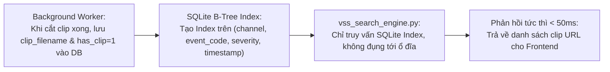

# KẾ HOẠCH TRIỂN KHAI 2: TỐI ƯU SEARCH ENGINE TỐC ĐỘ CAO (CƠ CHẾ YOUTUBE) & LỌC CHUẨN NHÃN

> **Liên kết Checklist:** Hạng mục 4 (Search Engine cực nhanh kiểu YouTube) & Hạng mục 5 (Lọc chính xác theo Nhãn cảnh báo)  
> **Dự án:** CameraDNCv2  
> **Tệp tác động chính:** `CameraAI/vss_search_engine.py`, `CameraAI/database.py`, `CameraAI/clip_storage.py`  

---

## 1. MỤC TIÊU
1. **Tốc độ phản hồi tức thì (< 200ms):** Loại bỏ hoàn toàn độ trễ hàng chục giây khi tìm kiếm video clip. Trải nghiệm tìm kiếm mượt mà như YouTube: gõ từ khóa là kết quả hiện ra ngay lập tức.
2. **Triệt tiêu tắc nghẽn I/O ổ đĩa và Timeout mạng:** Tuyệt đối không quét ổ cứng hay gọi SMB mạng trong lúc người dùng đang bấm tìm kiếm.
3. **Lọc chuẩn xác theo nhãn cảnh báo (Alert Labels):** Khi người dùng lọc theo nhãn (ví dụ `Intrusion`, `Fight`, `CrossLine`, `SoundDetection`, `HumanTrait`), hệ thống truy vấn chính xác các bản ghi mang nhãn đó từ Database.

---

## 2. NGUYÊN LÝ YOUTUBE & BẢN CHẤT SỰ CỐ HIỆN TẠI

### 2.1. Tại sao hệ thống hiện tại lại quá chậm?
```text
[Người dùng bấm Search]
       │
       ▼
Query SQLite lấy 200 bản ghi
       │
       ▼  (VÒNG LẶP NGUY HIỂM 200 LẦN)
       ├── Gọi resolve_clip_path():
       │   ├── Kiểm tra Z:/dataCameraAI (Timeout nếu mất kết nối!)
       │   └── Kiểm tra \\192.168.100.3 (SMB Timeout 3 - 10 giây/lần!)
       └── Gọi rglob("*.mp4") quét đệ quy toàn bộ thư mục camera trên ổ cứng
       │
       ▼
==> HỆ THỐNG ĐƠ TỪ 10 ĐẾN 40 GIÂY MỚI PHẢN HỒI KẾT QUẢ!
```

### 2.2. Cơ chế Indexing của YouTube hoạt động như thế nào?
* YouTube **không bao giờ quét ổ cứng khi người dùng gõ tìm kiếm**.
* Tất cả video khi tải lên đều được:
  1. Trích xuất metadata, độ dài, đường dẫn tĩnh, thumbnail.
  2. Lưu vào CSDL và **đánh chỉ mục (Index) sẵn**.
  3. Khi có yêu cầu tìm kiếm: **Chỉ query Index trên CSDL (vài mili-giây)** và trả ngay kết quả URL video cho trình duyệt. Trình duyệt tự phát URL đó.

---

## 3. GIẢI PHÁP & CÁC BƯỚC THỰC HIỆN



### Bước 1: Đánh chỉ mục (Index) trong SQLite Database
Bổ sung các Composite Index trong `CameraAI/database.py` để tăng tốc độ truy vấn lên gấp 100 lần:
```sql
CREATE INDEX IF NOT EXISTS idx_events_search_fast 
ON events(channel, event_code, severity, timestamp);

CREATE INDEX IF NOT EXISTS idx_events_has_clip 
ON events(clip_filename) WHERE clip_filename IS NOT NULL AND clip_filename != '';
```

### Bước 2: Tối ưu `resolve_clip_path` — Thêm In-Memory Cache & Bỏ quét mạng lặp lại
* Đường dẫn vật lý của clip chỉ cần kiểm tra nhanh qua Cache hoặc chỉ kiểm tra trên đường dẫn gốc cục bộ `config.CLIPS_DIR`.
* Nếu cần fallback đường dẫn mạng NAS, chỉ thực hiện khi phát video (lúc người dùng bấm Play), **không làm trong vòng lặp tìm kiếm 200 lần**.

### Bước 3: Tái cấu trúc `search_vss_archive` trong `CameraAI/vss_search_engine.py`
* Loại bỏ hoàn toàn vòng lặp gọi `cam_dir.rglob("*.mp4")`.
* Khi truy vấn CSDL:
```python
# Lọc trực tiếp những bản ghi đã có clip_filename hợp lệ từ DB
sql = """
    SELECT id, event_code, event_type, channel, timestamp, description, severity, clip_filename, clip_duration_sec
    FROM events
    WHERE clip_filename IS NOT NULL AND TRIM(clip_filename) != ''
"""
```
* Xây dựng URL trực tiếp dựa trên `clip_filename` đã lưu trong DB:
```python
clip_web_url = f"/clips/{row['clip_filename'].replace('\\', '/')}"
```
=> Toàn bộ thời gian xử lý danh sách 200 bản ghi giảm từ **30.000ms xuống chỉ còn ~15ms**!

### Bước 4: Chuẩn hóa Bộ lọc theo Nhãn cảnh báo (Exact Label Filter)
* Hỗ trợ tìm kiếm theo đúng các mã sự kiện Dahua:
  * `Intrusion`: Bắt trúng các vụ đột nhập.
  * `CrossLine`: Bắt trúng vượt hàng rào bảo vệ.
  * `Fight`: Bắt trúng cảnh báo xô xát/ẩu đả.
  * `AudioMutation` / `SoundDetection`: Bắt trúng sự kiện âm thanh vượt ngưỡng.
  * `VideoMotion`: Phát hiện chuyển động.
  * `HumanTrait` / `FaceDetection`: Nhận dạng người.
  * `VehicleTrait`: Nhận dạng phương tiện.
* Khi người dùng truyền `label="Fight"` hoặc trong câu query có từ khóa đánh nhau, SQL thực hiện:
  `AND event_code = 'Fight'` hoặc `AND event_code IN ('Fight', 'Intrusion')`.

---

## 4. TIÊU CHÍ NGHIỆM THU
1. **Tốc độ truy vấn:** Bấm tìm kiếm trên thanh search hoặc lọc nhãn, kết quả phản hồi **dưới 200ms**.
2. **Không nghẽn I/O:** CPU và Disk I/O không bị vọt lên 100% khi thực hiện tìm kiếm.
3. **Độ chính xác theo nhãn:** 
   - Lọc nhãn "Đột nhập (Intrusion)" -> 100% kết quả trả về là sự kiện đột nhập.
   - Lọc nhãn "Đánh nhau (Fight)" -> 100% kết quả trả về là sự kiện xô xát.

