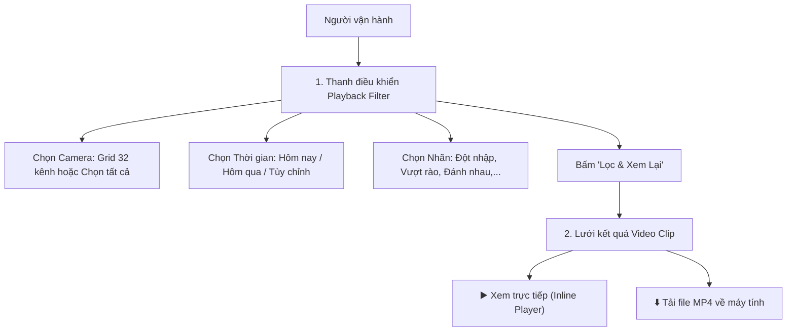

# 🎬 KẾ HOẠCH TRIỂN KHAI 3: NÂNG CẤP BỘ LỌC (FILTER) THÀNH GIAO DIỆN PLAYBACK & TẢI MP4

> **Liên kết Checklist:** Hạng mục 6 (Cải tổ Filter khó dùng thành màn hình Playback thực thụ)  
> **Dự án:** CameraDNCv2  
> **Tệp tác động chính:** `CameraAI/templates/index.html`, `CameraAI/static/js/app.js`, `CameraAI/static/css/style.css`  

---

## 🎯 1. MỤC TIÊU
1. **Khắc phục triệt để trải nghiệm Filter hiện tại:** 
   - Loại bỏ ô multi-select bắt bấm giữ `Ctrl` khó chịu.
   - Thay thế bằng giao diện chọn nhanh trực quan (Card/Chip/Buttons).
2. **Trải nghiệm Playback hoàn chỉnh:**
   - Người dùng chọn Camera + Khoảng thời gian + Nhãn cảnh báo -> Hệ thống hiển thị danh sách clip phù hợp.
   - **Xem trực tiếp:** Bấm vào clip nào là video phát ngay tức thì với thanh tua timeline mượt mà (inline player).
   - **Tải về:** Có nút **Tải MP4** trực tiếp để người vận hành lưu video về máy tính cá nhân làm bằng chứng chỉ với 1 click.

---

## 🔍 2. SO SÁNH TRẢI NGHIỆM TRƯỚC VÀ SAU CẢI TỔ

| Đặc điểm | Hiện tại (Cần thay thế) | Sau cải tổ (Chuẩn Playback) |
|:---|:---|:---|
| **Chọn Camera** | Dropdown `<select multiple>` bắt giữ phím Ctrl | Lưới chọn nhanh 32 Camera (có nút *Tất cả*, *Chọn nhanh tầng/khu vực*) |
| **Chọn Thời gian** | Ô datetime-local nhập tay dễ sai | Bộ chọn trực quan: Nút nhanh (*Hôm nay, Hôm qua, 1h trước*) + Lịch chọn từ ngày đến ngày |
| **Chọn Nhãn** | Không có nút chọn nhãn rõ ràng | Hàng thẻ Chip bấm chọn (*Đột nhập, Đánh nhau, Người, Xe, Âm thanh*) |
| **Xem Video** | Modal rời hoặc không xem được | **Inline Video Player:** Phát ngay trong khung xem kèm timeline |
| **Tải Video** | Không có nút tải về hoặc khó tìm | **Nút Download MP4** nổi bật trên mỗi thẻ clip và trong khung phát |

---

## 🛠️ 3. THIẾT KẾ GIAO DIỆN & TÍNH NĂNG



### 3.1. Thiết kế lại Popover / Drawer Bộ lọc Playback
* **Khu vực 1 - Chọn Kênh Camera:**
  * Hàng nút tắt: `[Toàn bộ Camera]`, `[Khu vực Sảnh]`, `[Khu Phòng ban]`, `[Bỏ chọn hết]`.
  * Lưới 32 nút bấm nhỏ (Badge): Kênh nào được chọn sẽ sáng viền xanh neon (`#00f5d4`), kênh không chọn để màu xám mờ.
* **Khu vực 2 - Chọn Thời gian:**
  * Các nút tắt nhanh: `[1 Giờ gần nhất]`, `[Hôm nay]`, `[Hôm qua]`.
  * 2 ô chọn thời gian: `Từ mốc` và `Đến mốc`.
* **Khu vực 3 - Chọn Nhãn sự kiện:**
  * Danh sách Chip: `[🚨 Đột nhập]`, `[⚔️ Đánh nhau]`, `[🚧 Vượt rào]`, `[🔊 Âm thanh lớn]`, `[👤 Người]`, `[🚗 Xe]`.

### 3.2. Thiết kế Thẻ Kết quả & Trình phát Playback
Trên mỗi thẻ video kết quả trả về:
* Thumbnail preview rõ nét kèm nhãn loại sự kiện và thời lượng (ví dụ: `10s`).
* Tên Camera: `Cam 11 - TTĐT Chuẩn Đầu Ra` kèm mốc thời gian: `14:32:05 - 06/10/2026`.
* **Nút bấm hành động kép:**
  * **Nút ▶ Phát trực tiếp:** Mở video player ngay tại chỗ để xem lại.
  * **Nút ⬇ Tải về (Download):** Tải trực tiếp file `evt_cam-xxx_YYYYMMDD.mp4` về thư mục Download của người dùng.

```html
<!-- Cấu trúc HTML của thẻ Video Playback -->
<div class="playback-card">
    <div class="playback-thumb-wrap" onclick="playInlineVideo('{clip_url}')">
        <video class="playback-thumb-video" preload="metadata" src="{clip_url}#t=0.5"></video>
        <span class="playback-duration">10s</span>
        <button class="playback-play-overlay">▶</button>
    </div>
    <div class="playback-info">
        <div class="playback-title">{event_label} - Cam {channel}</div>
        <div class="playback-time">{timestamp}</div>
        <div class="playback-actions">
            <button class="btn-playback-view" onclick="playInlineVideo('{clip_url}')">▶ Xem lại</button>
            <a class="btn-playback-download" href="{clip_url}" download="Camera_{channel}_{timestamp}.mp4" title="Tải video MP4">⬇ Tải MP4</a>
        </div>
    </div>
</div>
```

---

## 🏁 4. TIÊU CHÍ NGHIỆM THU
1. **Dễ thao tác:** Người dùng chỉ mất dưới 5 giây để chọn camera, thời gian và nhãn mà không cần dùng bàn phím hay giữ phím Ctrl.
2. **Xem trực tiếp:** Bấm vào clip là video phát ngay tức thì, tua được timeline mượt mà.
3. **Tải về thành công:** Bấm nút Tải MP4 thì trình duyệt tải về file video chuẩn `.mp4`, mở bằng Windows Media Player / VLC xem bình thường với đầy đủ hình ảnh và âm thanh.

