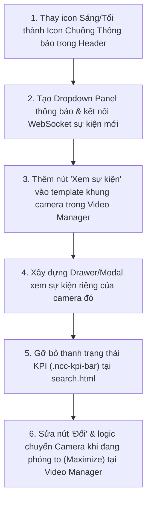

# KẾ HOẠCH TRIỂN KHAI 4: GIAO DIỆN THÔNG BÁO (NOTIFICATION) & XEM SỰ KIỆN CAMERA TẠI VIDEO MANAGER

> **Liên kết Checklist:** Hạng mục 1 (Thay icon Dark/Light thành Icon Thông báo) & Hạng mục 2 (Ô xem sự kiện riêng từng Camera trong Video Manager)  
> **Dự án:** CameraDNCv2  
> **Tệp tác động chính:** `CameraAI/templates/index.html`, `CameraAI/static/js/app.js`, `CameraAI/static/css/style.css`  

---

## 1. MỤC TIÊU
1. **Chuyển đổi Icon trên Header Bar:** Thay thế nút Dark/Light Mode (sáng/tối) bằng biểu tượng **Chuông Thông Báo (Notification Bell)**. Khởi tạo sẵn cấu trúc Notification Popover/Drawer để sau này hệ thống tải và hiển thị danh sách cảnh báo sự kiện mới nhất tại vị trí này.
2. **Xem sự kiện nhanh theo từng Camera trong Video Manager:**
   - Trên mỗi khung hình camera hiển thị trong Video Manager, gắn thêm **1 ô nhỏ (Quick Event Box / Badge)**.
   - Khi người vận hành bấm vào ô này trên camera nào, một giao diện popup/drawer sẽ xuất hiện hiển thị **toàn bộ lịch sử sự kiện & video clip đã xảy ra riêng trên camera đó**.
3. **Loại bỏ Thanh Trạng Thái KPI (`Bottom Floating KPI Capacity Bar`):**
   - Gỡ bỏ thanh chỉ số ảo/rườm rà phía dưới màn hình (`32 TỔNG CAMERA | 3 NVR LIVE / 32 TRỰC TUYẾN (ONLINE) | 2 CẢNH BÁO (ALERTS) | 13.5 MBPS BĂNG THÔNG | 25.0 FPS TRUNG BÌNH | ACTIVE YOLOV8 + VSS VISION`) tại `CameraAI/templates/search.html` để giao diện gọn gàng, tập trung diện tích cho khung xem Camera và bảng sự kiện.
4. **Sửa lỗi khi Phóng to (Maximize) tại Video Manager không chuyển xem Camera khác bằng nút `Đổi` được:**
   - Khắc phục triệt để lỗi bấm nút `Đổi` trên khung camera đang phóng to nhưng không hiện danh sách chọn nhanh hoặc chọn camera khác nhưng màn hình phóng to không chịu đổi sang camera đó.

---

## 2. CHI TIẾT THIẾT KẾ & TÍNH NĂNG

### 2.1. Hạng mục 1: Icon Thông báo trên Header Bar
* **Vị trí:** Góc phải của Header Bar (vị trí cũ của icon mặt trăng / mặt trời).
* **Thiết kế UI:**
  * Icon chiếc chuông viền neon hiện đại (`<svg>` hoặc Icon Font).
  * Chấm đỏ thông báo số lượng sự kiện mới (`Notification Badge`, ví dụ hiển thị số `3` hoặc chấm nhấp nháy khi có cảnh báo nguy hiểm).
  * Khi click vào icon: Mở ra bảng danh sách thông báo thả xuống (Notification Dropdown) với các sự kiện gần nhất (ví dụ: *Đột nhập lúc 10:15 tại Cam 11*, *Âm thanh 92dB lúc 10:30 tại Cam 18*).

```html
<!-- Cấu trúc Notification Bell trên Header -->
<div class="notification-wrapper">
    <button class="btn-notification-bell" onclick="toggleNotificationDropdown()" title="Thông báo sự kiện">
        <svg viewBox="0 0 24 24" width="20" height="20" fill="none" stroke="currentColor" stroke-width="2">
            <path d="M18 8A6 6 0 0 0 6 8c0 7-3 9-3 9h18s-3-2-3-9"></path>
            <path d="M13.73 21a2 2 0 0 1-3.46 0"></path>
        </svg>
        <span class="notification-badge" id="header-alert-count">0</span>
    </button>
    <!-- Dropdown chứa danh sách sự kiện sau này -->
    <div class="notification-dropdown" id="notification-dropdown" style="display:none;">
        <div class="notif-header">
            <span>Thông báo Sự kiện Hệ thống</span>
            <button class="notif-clear-btn" onclick="clearNotifications()">Đã xem</button>
        </div>
        <div class="notif-list" id="notif-items-container">
            <!-- Tải động các sự kiện thời gian thực tại đây -->
        </div>
    </div>
</div>
```

---

### 2.2. Hạng mục 2: Ô xem sự kiện riêng cho từng Camera trong Video Manager
* **Vị trí:** Góc trên bên phải (hoặc góc dưới) trên khung hiển thị của từng camera trong lưới Video Manager.
* **Thiết kế UI ô nhỏ:**
  * Một nút bấm nhỏ dạng huy hiệu (Badge/Pill) trong suốt với icon lịch sử: ` Xem sự kiện` hoặc ` [Số sự kiện]`.
  * Có hiệu ứng hover sáng viền để người vận hành dễ nhận biết có thể click.
* **Hành vi khi click vào ô này:**
  * Mở Modal / Side-Drawer có tiêu đề: **"Nhật ký sự kiện & Video xem lại — Camera Kênh XX"**.
  * Gọi API backend: `/api/events?channel={channel_id}&limit=50`.
  * Hiển thị danh sách các sự kiện của đúng kênh đó kèm:
    * Mốc thời gian
    * Nhãn sự kiện (Đột nhập, Chuyển động, Nhận dạng người,...)
    * Nút bấm xem ngay video clip 10 giây tương ứng.

```html
<!-- Ô nhỏ trên khung từng Camera -->
<div class="cam-card-overlay-actions">
    <button class="btn-cam-quick-events" onclick="openChannelEventDrawer({channel_id})" title="Xem lại tất cả sự kiện của camera này">
        <span class="icon-pulse"></span>
        <span>Sự kiện Cam {channel_id}</span>
    </button>
</div>
```

---

### 2.3. Hạng mục 3: Bỏ Thanh Trạng Thái KPI (`ncc-kpi-bar`) trong `search.html`
* **Vị trí trong mã nguồn:** [CameraAI/templates/search.html (dòng 6539–6569)](file:///d:/CameraDNCv2/CameraAI/templates/search.html#L6539-L6569).
* **Nội dung thanh cần bỏ:**
  * `32 TỔNG CAMERA` (`#kpi-total-cams`)
  * `3 NVR LIVE / 32 TRỰC TUYẾN (ONLINE)` (`#kpi-online-cams`)
  * `2 CẢNH BÁO (ALERTS)` (`#kpi-alert-cams`)
  * `13.5 MBPS BĂNG THÔNG` (`#kpi-network-bitrate`)
  * `25.0 FPS TRUNG BÌNH` (`#kpi-avg-fps`)
  * `ACTIVE YOLOV8 + VSS VISION`
* **Cách xử lý:**
  * Xóa (hoặc ẩn triệt để) khối `<div class="ncc-kpi-bar">...</div>` trong `CameraAI/templates/search.html`.
  * Dọn dẹp các đoạn JS cập nhật `#kpi-online-cams`, `#kpi-network-bitrate`, `#kpi-avg-fps` (tại dòng `~10971` và `~12002` trong `search.html`) để tránh lỗi tham chiếu DOM không cần thiết và mở rộng chiều cao hiển thị cho khung danh sách sự kiện / lưới camera.

```html
<!-- Khối cần gỡ bỏ tại CameraAI/templates/search.html (Dòng 6539 - 6569) -->
<!-- 4. Bottom Floating KPI Capacity Bar -->
<div class="ncc-kpi-bar">
    ...
</div>
```

---

### 2.4. Hạng mục 4: Sửa lỗi Phóng to (Maximize) tại Video Manager không chuyển coi Camera khác bằng nút `Đổi` được

* **Nguyên nhân gốc rễ trong mã nguồn ([CameraAI/templates/search.html dòng 11386–11483](file:///d:/CameraDNCv2/CameraAI/templates/search.html#L11386-L11483)):**
  1. **Nút `Đổi` (`promptChangeSlotCamera(slotIdx)` tại dòng 11472) không hiện bảng chọn Camera tại chỗ:**
     - Hiện tại hàm `promptChangeSlotCamera(slotIdx)` chỉ gọi `setNccTargetSlot(slotIdx)` rồi `searchInput.focus()` ở thanh sidebar bên trái. Khi người dùng đang phóng to toàn khung hình hoặc nhìn vào nút `Đổi` trên góc phải ô camera, bấm vào nút `Đổi` không thấy bất kỳ menu hay danh sách chọn camera nào bật ra!
  2. **Lỗi tự động nhảy sang ô ẩn sau khi đổi (`assignCameraToTargetSlot` tại dòng 11453):**
     ```javascript
     // Advance target slot to next slot
     const nextIdx = (targetIdx + 1) % 4;
     setNccTargetSlot(nextIdx);
     ```
     - Khi đang phóng to **Ô 1** (`nccMaximizedSlotIndex = 0`), người dùng đổi sang xem 1 camera xong, hệ thống tự động đẩy `nccTargetSlotIndex` sang **Ô 2** (`nextIdx = 1` — lúc này đang bị ẩn vì Ô 1 đang phóng to!). Khi người dùng bấm chọn tiếp 1 camera khác ở sidebar, hệ thống lại gán camera đó vào **Ô 2 (đang ẩn)** chứ không đổi trên **Ô 1 (đang phóng to)**.
  3. **Lỗi chặn đổi nếu Camera đó đang nằm ở 1 trong 3 ô bị ẩn (`assignCameraToTargetSlot` tại dòng 11394–11405):**
     ```javascript
     const existingSlot = nccActiveSlots.indexOf(numId);
     if (existingSlot !== -1) {
         setNccTargetSlot(existingSlot);
         return; // <-- LỖI: Đang phóng to Ô 1, muốn đổi sang xem Camera đang nằm ở Ô 2 thì bị return luôn, màn hình phóng to đứng im!
     }
     ```
     - Nếu người dùng đang phóng to **Ô 1** (Cam 11) và muốn chuyển sang xem **Cam 18** (vốn đang nằm ở Ô 2 đang bị ẩn), hàm `assignCameraToTargetSlot(18)` phát hiện `existingSlot = 1` nên `return` thoát luôn mà không chịu đưa Cam 18 lên khung đang phóng to!

* **Giải pháp kỹ thuật triệt để:**
  1. **Tích hợp Popover/Dropdown chọn nhanh Camera ngay tại nút `Đổi` (kèm nút mũi tên `◀ Cam trước` / `Cam sau ▶` khi đang phóng to):**
     - Khi bấm vào nút `Đổi` trên bất kỳ ô nào (đặc biệt khi đang phóng to), hiển thị ngay một **Menu thả xuống (Quick Camera Switcher Dropdown)** ngay dưới nút `Đổi` liệt kê danh sách 32 Camera (có ô tìm nhanh), bấm vào camera nào là đổi ngay tức khắc trên khung đó.
     - Bổ sung thêm 2 nút chuyển nhanh **`◀` (Cam trước)** và **`▶` (Cam kế tiếp)** trên thanh tiêu đề khi đang phóng to để lướt qua các camera chỉ bằng 1 click.
  2. **Khóa `targetIdx` vào đúng ô đang phóng to (`nccMaximizedSlotIndex`):**
     - Trong `assignCameraToTargetSlot(camId)`: Nếu `nccMaximizedSlotIndex !== null`, luôn bắt buộc `targetIdx = nccMaximizedSlotIndex` và **không tự động nhảy `nextIdx = (targetIdx + 1) % 4`** (giữ nguyên mục tiêu tại ô đang phóng to để người dùng có thể bấm đổi liên tiếp 10 camera khác nhau ngay trên màn hình phóng to).
  3. **Cho phép hoán đổi (Swap) nếu chọn Camera đang nằm ở ô khác:**
     - Khi đang phóng to Ô `targetIdx`, nếu người dùng chọn `camId` vốn đang nằm ở `existingSlot` (`existingSlot !== targetIdx`), thực hiện **hoán đổi vị trí (swap)** `nccActiveSlots[existingSlot] = nccActiveSlots[targetIdx]` và gán `nccActiveSlots[targetIdx] = camId`, sau đó gọi `renderNccGrid()` để cập nhật lại toàn bộ luồng stream và nút `Sự kiện` của đúng camera mới.

```javascript
// Logic sửa lỗi trong assignCameraToTargetSlot(camId) và promptChangeSlotCamera(slotIdx)
function assignCameraToTargetSlot(camId) {
    const numId = Number(camId);
    // Nếu đang phóng to 1 ô, luôn ưu tiên đổi ngay trên ô đang phóng to đó
    const targetIdx = (nccMaximizedSlotIndex !== null) ? nccMaximizedSlotIndex : nccTargetSlotIndex;
    const existingSlot = nccActiveSlots.indexOf(numId);

    if (existingSlot !== -1) {
        if (nccMaximizedSlotIndex !== null && existingSlot !== targetIdx) {
            // Hoán đổi camera giữa ô đang phóng to và ô đang ẩn
            nccActiveSlots[existingSlot] = nccActiveSlots[targetIdx];
        } else if (nccMaximizedSlotIndex === null) {
            setNccTargetSlot(existingSlot);
            return;
        }
    }

    nccActiveSlots[targetIdx] = numId;
    localStorage.setItem('ncc_active_slots_v4', JSON.stringify(nccActiveSlots));

    // Khi KHÔNG phóng to mới tự động nhảy sang ô kế tiếp; khi ĐANG phóng to thì giữ nguyên ô đó
    if (nccMaximizedSlotIndex === null) {
        setNccTargetSlot((targetIdx + 1) % 4);
    } else {
        setNccTargetSlot(nccMaximizedSlotIndex);
    }

    renderNccGrid();
    renderVmSidebarSlotPills();
    renderVmSidebarCameraList();
}
```

---

## 3. CÁC BƯỚC TRIỂN KHAI



1. **Bước 1:** Cập nhật `templates/index.html` / `templates/search.html` thay thế button theme switch bằng `btn-notification-bell` và `notification-dropdown`.
2. **Bước 2:** Bổ sung CSS hiệu ứng badge nhấp nháy màu đỏ khi có cảnh báo mới trong `static/css/style.css`.
3. **Bước 3:** Cập nhật hàm render danh sách Camera trong Video Manager, chèn nút `btn-cam-quick-events` vào từng ô camera.
4. **Bước 4:** Viết hàm JavaScript `openChannelEventDrawer(channelId)` để fetch danh sách sự kiện riêng của camera đó và hiển thị lên Drawer/Modal.
5. **Bước 5:** Xóa khối `<div class="ncc-kpi-bar">` tại `CameraAI/templates/search.html` (dòng 6539–6569).
6. **Bước 6:** Cập nhật `promptChangeSlotCamera(slotIdx)` (hiển thị popup/dropdown chọn nhanh camera ngay tại nút `Đổi`) và sửa `assignCameraToTargetSlot(camId)` để khi đang phóng to có thể đổi sang bất kỳ camera nào (kể cả camera ở ô khác hoặc đổi liên tiếp nhiều lần).

---

## 4. TIÊU CHÍ NGHIỆM THU
1. **Header:** Không còn icon mặt trăng/mặt trời, thay thế bằng icon Chuông thông báo. Khi có sự kiện cảnh báo mới, chuông hiển thị số badge đỏ.
2. **Video Manager:** Trên mỗi ô camera đều có ô/nút xem sự kiện rõ ràng.
3. **Độ chính xác dữ liệu:** Click vào ô sự kiện của Camera 11 thì chỉ hiển thị sự kiện của Camera 11; click vào Camera 18 chỉ hiển thị sự kiện của Camera 18, không bao giờ bị lẫn lộn giữa các camera.
4. **Giao diện sạch gọn:** Thanh KPI dưới đáy (`32 TỔNG CAMERA | 3 NVR LIVE / 32 | ... | ACTIVE YOLOV8 + VSS VISION`) được loại bỏ hoàn toàn khỏi màn hình.
5. **Đổi Camera mượt mà khi Phóng to:** Khi đang phóng to bất kỳ ô nào trong Video Manager, bấm nút `Đổi` (hoặc chọn từ danh sách bên trái) đều lập tức chuyển khung đang phóng to sang Camera mới, đổi liên tiếp nhiều lần không bị kẹt hay nhảy nhầm sang ô đang ẩn.

