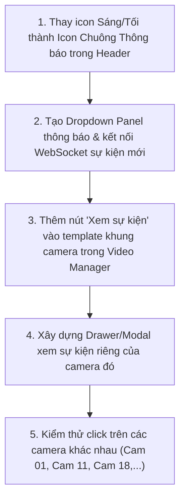

# 🔔 KẾ HOẠCH TRIỂN KHAI 4: GIAO DIỆN THÔNG BÁO (NOTIFICATION) & XEM SỰ KIỆN CAMERA TẠI VIDEO MANAGER

> **Liên kết Checklist:** Hạng mục 1 (Thay icon Dark/Light thành Icon Thông báo) & Hạng mục 2 (Ô xem sự kiện riêng từng Camera trong Video Manager)  
> **Dự án:** CameraDNCv2  
> **Tệp tác động chính:** `CameraAI/templates/index.html`, `CameraAI/static/js/app.js`, `CameraAI/static/css/style.css`  

---

## 🎯 1. MỤC TIÊU
1. **Chuyển đổi Icon trên Header Bar:** Thay thế nút Dark/Light Mode (sáng/tối) bằng biểu tượng **Chuông Thông Báo (Notification Bell)**. Khởi tạo sẵn cấu trúc Notification Popover/Drawer để sau này hệ thống tải và hiển thị danh sách cảnh báo sự kiện mới nhất tại vị trí này.
2. **Xem sự kiện nhanh theo từng Camera trong Video Manager:**
   - Trên mỗi khung hình camera hiển thị trong Video Manager, gắn thêm **1 ô nhỏ (Quick Event Box / Badge)**.
   - Khi người vận hành bấm vào ô này trên camera nào, một giao diện popup/drawer sẽ xuất hiện hiển thị **toàn bộ lịch sử sự kiện & video clip đã xảy ra riêng trên camera đó**.

---

## 🔍 2. CHI TIẾT THIẾT KẾ & TÍNH NĂNG

### 2.1. Hạng mục 1: Icon Thông báo trên Header Bar
* **Vị trí:** Góc phải của Header Bar (vị trí cũ của icon mặt trăng / mặt trời).
* **Thiết kế UI:**
  * Icon chiếc chuông viền neon hiện đại (`<svg>` hoặc Icon Font).
  * Chấm đỏ thông báo số lượng sự kiện mới (`Notification Badge`, ví dụ hiển thị số `3` hoặc chấm nhấp nháy khi có cảnh báo nguy hiểm).
  * Khi click vào icon: Mở ra bảng danh sách thông báo thả xuống (Notification Dropdown) với các sự kiện gần nhất (ví dụ: *Đột nhập lúc 10:15 tại Cam 11*, *Âm thanh 92dB lúc 10:30 tại Cam 18*).

```html
<!-- Cấu trúc Notification Bell trên Header -->
<div class="notification-wrapper">
    <button class="btn-notification-bell" onclick="toggleNotificationDropdown()" title="Thông báo sự kiện">
        <svg viewBox="0 0 24 24" width="20" height="20" fill="none" stroke="currentColor" stroke-width="2">
            <path d="M18 8A6 6 0 0 0 6 8c0 7-3 9-3 9h18s-3-2-3-9"></path>
            <path d="M13.73 21a2 2 0 0 1-3.46 0"></path>
        </svg>
        <span class="notification-badge" id="header-alert-count">0</span>
    </button>
    <!-- Dropdown chứa danh sách sự kiện sau này -->
    <div class="notification-dropdown" id="notification-dropdown" style="display:none;">
        <div class="notif-header">
            <span>Thông báo Sự kiện Hệ thống</span>
            <button class="notif-clear-btn" onclick="clearNotifications()">Đã xem</button>
        </div>
        <div class="notif-list" id="notif-items-container">
            <!-- Tải động các sự kiện thời gian thực tại đây -->
        </div>
    </div>
</div>
```

---

### 2.2. Hạng mục 2: Ô xem sự kiện riêng cho từng Camera trong Video Manager
* **Vị trí:** Góc trên bên phải (hoặc góc dưới) trên khung hiển thị của từng camera trong lưới Video Manager.
* **Thiết kế UI ô nhỏ:**
  * Một nút bấm nhỏ dạng huy hiệu (Badge/Pill) trong suốt với icon lịch sử: `📜 Xem sự kiện` hoặc `🚨 [Số sự kiện]`.
  * Có hiệu ứng hover sáng viền để người vận hành dễ nhận biết có thể click.
* **Hành vi khi click vào ô này:**
  * Mở Modal / Side-Drawer có tiêu đề: **"Nhật ký sự kiện & Video xem lại — Camera Kênh XX"**.
  * Gọi API backend: `/api/events?channel={channel_id}&limit=50`.
  * Hiển thị danh sách các sự kiện của đúng kênh đó kèm:
    * Mốc thời gian
    * Nhãn sự kiện (Đột nhập, Chuyển động, Nhận dạng người,...)
    * Nút bấm xem ngay video clip 10 giây tương ứng.

```html
<!-- Ô nhỏ trên khung từng Camera -->
<div class="cam-card-overlay-actions">
    <button class="btn-cam-quick-events" onclick="openChannelEventDrawer({channel_id})" title="Xem lại tất cả sự kiện của camera này">
        <span class="icon-pulse">🔴</span>
        <span>Sự kiện Cam {channel_id}</span>
    </button>
</div>
```

---

## 🛠️ 3. CÁC BƯỚC TRIỂN KHAI



1. **Bước 1:** Cập nhật `templates/index.html` thay thế button theme switch bằng `btn-notification-bell` và `notification-dropdown`.
2. **Bước 2:** Bổ sung CSS hiệu ứng badge nhấp nháy màu đỏ khi có cảnh báo mới trong `static/css/style.css`.
3. **Bước 3:** Cập nhật hàm render danh sách Camera trong Video Manager (`app.js`), chèn nút `btn-cam-quick-events` vào từng ô camera.
4. **Bước 4:** Viết hàm JavaScript `openChannelEventDrawer(channelId)` để fetch danh sách sự kiện riêng của camera đó và hiển thị lên Drawer/Modal.

---

## 🏁 4. TIÊU CHÍ NGHIỆM THU
1. **Header:** Không còn icon mặt trăng/mặt trời, thay thế bằng icon Chuông thông báo. Khi có sự kiện cảnh báo mới, chuông hiển thị số badge đỏ.
2. **Video Manager:** Trên mỗi ô camera đều có ô/nút xem sự kiện rõ ràng.
3. **Độ chính xác dữ liệu:** Click vào ô sự kiện của Camera 11 thì chỉ hiển thị sự kiện của Camera 11; click vào Camera 18 chỉ hiển thị sự kiện của Camera 18, không bao giờ bị lẫn lộn giữa các camera.

