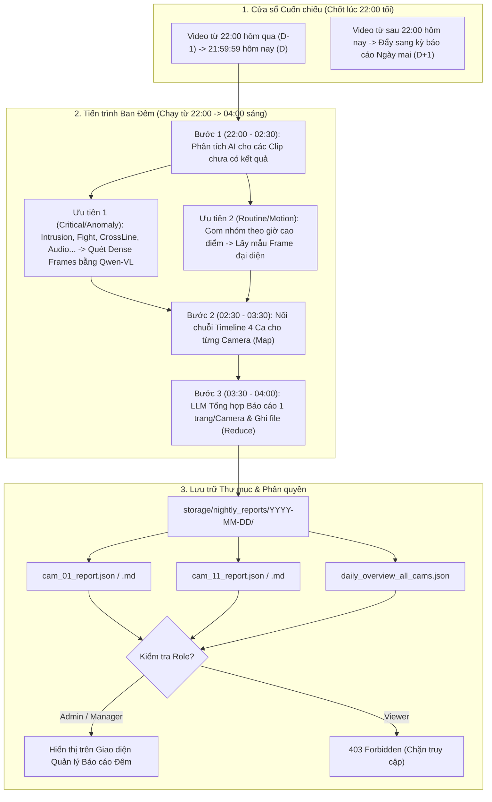

# KẾ HOẠCH TRIỂN KHAI 5: HỆ THỐNG PHÂN TÍCH VIDEO BAN ĐÊM (22H - 04H) & XUẤT BÁO CÁO NGÀY TỪNG CAMERA

> **Tính năng:** Tự động phân tích cuốn chiếu toàn bộ video 1 ngày trong khung giờ thấp điểm (`22:00 -> 04:00` sáng hôm sau) và xuất báo cáo ngắn gọn cho từng Camera vào thư mục riêng cho cấp `Admin` / `Manager`.  
> **Dự án:** CameraDNCv2  
> **Tệp dự kiến tác động / khởi tạo:**
> - `CameraAI/nightly_report_worker.py` *(Mới - Worker chạy ngầm ban đêm & hợp nhất báo cáo)*
> - `CameraAI/config.py` *(Cấu hình giờ chạy 22h-4h, thư mục lưu báo cáo)*
> - `CameraAI/database.py` *(Truy vấn theo cửa sổ thời gian cuốn chiếu 22h hôm trước -> 22h hôm nay)*
> - `CameraAI/main.py` *(API phân quyền Admin/Manager duyệt thư mục & xem báo cáo)*
> - `CameraAI/templates/index.html`, `CameraAI/static/js/app.js` *(Giao diện Thư mục Báo cáo Ngày cho Admin/Manager)*

---

## 1. MỤC TIÊU & BÀI TOÁN CỐT LÕI

1. **Cửa sổ thời gian cuốn chiếu (Rolling Cutoff 22:00):**
   - Kỳ báo cáo của **Ngày `D`** sẽ bao gồm toàn bộ video/sự kiện từ **`22:00:00` ngày `D-1`** đến **`21:59:59` ngày `D`**.
   - Mọi video phát sinh từ `22:00:00` ngày `D` trở đi sẽ tự động được đẩy sang kỳ báo cáo của **Ngày `D+1`**, cứ thế nối tiếp liên tục không bỏ sót bất kỳ giây nào.
2. **Xử lý tự động trong khung giờ vàng (`22:00 -> 04:00` sáng):**
   - Đúng `22:00` mỗi tối, hệ thống tự động khóa sổ dữ liệu của 24h vừa qua (`22h hôm qua -> 22h hôm nay`) và kích hoạt Worker phân tích chạy ngầm đến tối đa `04:00` sáng.
   - Tận dụng 6 tiếng ban đêm (lúc hệ thống ít người truy cập và ít sự kiện mới) để chạy AI Vision (Qwen-VL / Gemini) phân tích sâu các video clip trong ngày.
3. **Đầu ra Báo cáo ngắn gọn theo từng Camera:**
   - Mỗi Camera có hoạt động sẽ có **1 bản báo cáo ngắn gọn, súc tích** (tổng quan mức độ an ninh, dòng thời gian nối tiếp theo ca, các sự kiện bất thường kèm mã `#EventID` và đường dẫn xem lại video).
4. **Lưu trữ theo thư mục & Phân quyền chặt chẽ (`Admin` & `Manager`):**
   - Lưu thành cấu trúc thư mục rõ ràng theo ngày (`storage/nightly_reports/YYYY-MM-DD/cam_XX_report.md` & `.json`).
   - Chỉ tài khoản từ cấp **`manager`** hoặc **`admin`** mới được phép truy cập thư mục và đọc báo cáo (hỗ trợ lọc theo kênh `allowed_channels` nếu Manager chỉ quản lý một số camera nhất định).

---

## 2. GIẢI PHÁP KIẾN TRÚC (TẠI SAO KHÔNG BỊ QUÁ TẢI?)

Nếu bắt AI xem từng khung hình của 32 camera suốt 24h thì không một GPU nào chạy kịp trong 6 tiếng. Giải pháp của chúng ta là **Kiến trúc Phễu Phân Tầng 3 Bước (3-Tier Map-Reduce Pipeline)**:



### 2.1. Quy tắc Chia Ca nối tiếp trong 1 Báo cáo Ngày
Để người quản lý đọc báo cáo thấy mạch lạc, 24 tiếng (`22:00 D-1` $\rightarrow$ `22:00 D`) của từng Camera được nối tiếp qua **4 Ca chuẩn**:
1. **Ca Đêm hôm trước (`22:00 - 06:00`):** Các video phát sinh sau 22h đêm qua được đẩy sang đầu báo cáo hôm nay.
2. **Ca Sáng (`06:00 - 12:00`):** Hoạt động đầu giờ làm việc/học tập.
3. **Ca Chiều (`12:00 - 18:00`):** Hoạt động buổi chiều.
4. **Ca Tối (`18:00 - 22:00`):** Hoạt động tối trước giờ chốt sổ 22:00.

### 2.2. Cơ chế Bảo vệ Thời gian (Time-Budget Guardrail) & Checkpoint
- **Lưu trạng thái (Checkpoint):** Mỗi khi phân tích xong 1 video hoặc tạo xong báo cáo của 1 camera, hệ thống ghi trạng thái vào `status.json` trong thư mục ngày hôm đó. Nếu nửa đêm mất điện hoặc khởi động lại server, worker tự động đọc `status.json` và làm tiếp từ chỗ đang dở, không làm lại từ đầu.
- **Deadline `03:15` sáng:** Nếu một ngày có quá nhiều sự kiện khiến việc quét video lẻ kéo dài đến `03:15` sáng vẫn chưa hết các sự kiện thông thường (`VideoMotion`), hệ thống sẽ tự động ngắt pha quét frame lẻ để chuyển sang pha **Tổng hợp văn bản báo cáo (Reduce)**, đảm bảo **100% trước `04:00` sáng** luôn có đủ báo cáo cho toàn bộ Camera.

---

## 3. CẤU TRÚC THƯ MỤC & MẪU BÁO CÁO ĐẦU RA

### 3.1. Cấu trúc thư mục vật lý
```text
CameraAI/storage/nightly_reports/
├── 2026-10-11/
│   ├── _job_status.json             # Tiến độ chạy ban đêm (22h -> 4h)
│   ├── _daily_master_summary.json   # Tổng hợp toàn bộ các kênh
│   ├── cam_01.json                  # Dữ liệu chuẩn hóa của Camera 01 (dùng để render UI đẹp)
│   ├── cam_01.md                    # File Markdown báo cáo ngắn gọn Camera 01 (để đọc/tải về)
│   ├── cam_02.json
│   └── cam_02.md
└── 2026-10-12/
    └── ...
```

### 3.2. Mẫu nội dung Báo cáo Ngắn gọn của 1 Camera (`cam_11.md`)
```markdown
# BÁO CÁO PHÂN TÍCH AI NGÀY 2026-10-12 — CAMERA 11 (11.T1. QUẢN LÝ HSSV)
- **Khung thời gian dữ liệu:** `2026-10-11 22:00:00` → `2026-10-12 21:59:59`
- **Thời điểm hoàn tất phân tích:** `2026-10-12 23:42:10`
- **Đánh giá mức độ an ninh:**  **CẦN CHÚ Ý (MEDIUM RISK)**
- **Thống kê nhanh:** Tổng `42` sự kiện | `2` Cảnh báo bất thường | `38` Lượt người | `0` Phương tiện

## 1. Tóm tắt Diễn biến Trong Ngày (AI Tổng hợp)
Trong chu kỳ 24h (từ 22h tối qua đến 22h tối nay), khu vực Camera 11 yên tĩnh vào ban đêm nhưng ghi nhận 1 sự kiện xâm nhập vùng cảnh báo lúc 23:15 tối qua (#14802 - nhân viên bảo vệ đi tuần tra). Ban ngày lưu lượng sinh viên và cán bộ ra vào tập trung đông nhất từ 08:30 đến 10:30 sáng. Lúc 17:40 chiều có 1 cảnh báo âm thanh lớn (#14910) nhưng qua phân tích hình ảnh chỉ là tiếng đóng cửa mạnh, không có xô xát.

## 2. Dòng thời gian nối tiếp theo Ca (22:00 hôm qua → 22:00 hôm nay)
-  **Ca Đêm (22:00 11/10 - 06:00 12/10):** Ghi nhận 02 sự kiện. Đáng chú ý lúc `23:15:04` [Sự kiện #14802 - Intrusion]: 01 người mặc đồng phục bảo vệ đi qua hành lang kiểm tra cửa.
-  **Ca Sáng (06:00 - 12:00 12/10):** Ghi nhận 24 sự kiện `HumanTrait`. Lưu lượng ra vào bình thường, cao điểm lúc 09:00 (11 lượt). Không có bất thường.
-  **Ca Chiều (12:00 - 18:00 12/10):** Ghi nhận 14 sự kiện. Lúc `17:40:22` [Sự kiện #14910 - AudioMutation (84dB)]: Tiếng động lớn khi đóng cửa phòng, hình ảnh không có dấu hiệu nguy hiểm.
-  **Ca Tối (18:00 - 22:00 12/10):** Ghi nhận 02 sự kiện chuyển động nhẹ lúc 18:15 khi nhân viên tắt điện ra về. Từ 18:30 đến 22:00 hoàn toàn yên tĩnh.

## 3. Danh sách Video Bất thường / Quan trọng cần xem lại
1. **[23:15:04 - 11/10] Sự kiện #14802 (`Intrusion`)** — Mức độ: `Low` — [ Xem Video Clip](/clips/2026-10-11/ch11_14802.mp4)
2. **[17:40:22 - 12/10] Sự kiện #14910 (`AudioMutation`)** — Mức độ: `Medium` — [ Xem Video Clip](/clips/2026-10-12/ch11_14910.mp4)
```

---

## 4. THIẾT KẾ API & PHÂN QUYỀN (`ADMIN` / `MANAGER`)

Toàn bộ API liên quan đến báo cáo đêm đều được bảo vệ qua hàm kiểm tra quyền `require_manager_or_admin(request)`:
- Nếu `role == "viewer"` hoặc chưa đăng nhập $\rightarrow$ Trả về `403 Forbidden`.
- Nếu `role == "manager"` có giới hạn kênh (`allowed_channels`) $\rightarrow$ Chỉ trả về các file báo cáo của những Camera nằm trong `allowed_channels`.
- Nếu `role == "admin"` $\rightarrow$ Xem được toàn bộ 32 Camera và có thêm nút **"Chạy phân tích ngay (Trigger Manual/Test)"**.

| Phương thức | Endpoint | Quyền hạn | Chức năng |
| :--- | :--- | :--- | :--- |
| `GET` | `/api/nightly-reports/dates` | `admin`, `manager` | Lấy danh sách các thư mục ngày đã có báo cáo (VD: `2026-10-12`, `2026-10-11`...) kèm trạng thái hoàn thành. |
| `GET` | `/api/nightly-reports/{report_date}` | `admin`, `manager` | Lấy danh sách báo cáo của từng Camera trong ngày đó (lọc theo `allowed_channels` của user). |
| `GET` | `/api/nightly-reports/{report_date}/camera/{channel_id}` | `admin`, `manager` | Xem chi tiết báo cáo JSON/Markdown của 1 Camera cụ thể + danh sách clip đính kèm. |
| `GET` | `/api/nightly-reports/{report_date}/camera/{channel_id}/download` | `admin`, `manager` | Tải file `.md` của Camera đó về máy. |
| `POST` | `/api/nightly-reports/trigger` | `admin` | Nút bấm cho phép Admin kích hoạt chạy thử báo cáo đêm ngay lập tức mà không cần đợi đến 22h tối. |

---

## 5. CÁC BƯỚC TRIỂN KHAI CHI TIẾT

1. **Bước 1 — Cấu hình trong `CameraAI/config.py`:**
   - Thêm biến cấu hình `NIGHTLY_REPORT_DIR = STORAGE_DIR / "nightly_reports"`.
   - Thêm cấu hình giờ bắt đầu `NIGHTLY_START_HOUR = 22`, giờ kết thúc `NIGHTLY_END_HOUR = 4`.
2. **Bước 2 — Truy vấn cửa sổ thời gian cuốn chiếu trong `CameraAI/database.py`:**
   - Viết hàm `get_events_in_rolling_window(start_ts: str, end_ts: str, channel: Optional[int] = None)` lấy toàn bộ sự kiện từ `YYYY-MM-DD(hôm trước) 22:00:00` đến `YYYY-MM-DD(hôm nay) 21:59:59`.
3. **Bước 3 — Xây dựng `CameraAI/nightly_report_worker.py`:**
   - Tạo bộ lập lịch ngầm (`NightlyReportScheduler`) kiểm tra mỗi phút: khi đồng hồ điểm `>= 22:00` và ngày hôm đó chưa có báo cáo hoàn chỉnh, tự động khởi chạy job.
   - Thực thi 3 pha:
     1. Quét AI bổ sung cho các clip quan trọng chưa được phân tích (`video_analysis_status != 'completed'`).
     2. Gom sự kiện theo 4 ca (`22h-06h`, `06h-12h`, `12h-18h`, `18h-22h`) cho từng Camera.
     3. Gọi LLM (`call_qwen_chat` / `gemini_video_report`) kèm bộ khung fallback Tiếng Việt chuẩn để sinh báo cáo ngắn gọn `.json` và `.md` lưu vào `storage/nightly_reports/YYYY-MM-DD/`.
4. **Bước 4 — Tích hợp API & Phân quyền trong `CameraAI/main.py`:**
   - Khởi động `nightly_report_worker` cùng vòng đời FastAPI startup.
   - Mở các API `/api/nightly-reports/...` kiểm tra chặt `role in ("admin", "manager")`.
5. **Bước 5 — Giao diện Xem Thư mục Báo cáo Ngày & Dọn gọn UI (`search.html` / `index.html`):**
   - Hiển thị mục **" Báo cáo Đêm (22h - 4h)"** (chỉ hiển thị khi tài khoản đăng nhập là `Admin` hoặc `Manager`).
   - Cho phép chọn Thư mục Ngày $\rightarrow$ Chọn Camera $\rightarrow$ Đọc báo cáo trực tiếp, bấm vào sự kiện để phát lại clip ngay trên màn hình.
   - **Gỡ bỏ thanh trạng thái KPI dưới đáy (`.ncc-kpi-bar`):** Xóa khối `Bottom Floating KPI Capacity Bar` (`32 TỔNG CAMERA | 3 NVR LIVE / 32 TRỰC TUYẾN (ONLINE) | 2 CẢNH BÁO (ALERTS) | 13.5 MBPS BĂNG THÔNG | 25.0 FPS TRUNG BÌNH | ACTIVE YOLOV8 + VSS VISION`) tại [CameraAI/templates/search.html (dòng 6539–6569)](file:///d:/CameraDNCv2/CameraAI/templates/search.html#L6539-L6569) để giao diện sạch gọn và nhường diện tích hiển thị.

---

## 6. TIÊU CHÍ NGHIỆM THU
1. **Đúng quy tắc cuốn chiếu 22:00:** Sự kiện lúc `21:59` ngày 12/10 nằm trong báo cáo ngày `12/10`; sự kiện lúc `22:05` ngày 12/10 tự động nằm trong phần mở đầu (Ca Đêm) của báo cáo ngày `13/10`.
2. **Tự động chạy ban đêm & Có thể test ngay:** Tự động kích hoạt trong khung `22:00 -> 04:00` sáng, đồng thời có nút **"Chạy tạo báo cáo ngay"** cho Admin kiểm thử bất cứ lúc nào.
3. **Lưu đúng thư mục vật lý:** Sinh đầy đủ các file báo cáo riêng cho từng camera trong `CameraAI/storage/nightly_reports/YYYY-MM-DD/`.
4. **Bảo mật phân quyền:** Tài khoản `viewer` hoàn toàn không nhìn thấy menu và bị chặn `403` nếu gọi API; tài khoản `manager` và `admin` xem và tải được báo cáo mượt mà.
5. **Giao diện sạch gọn:** Không còn thanh KPI dưới đáy (`32 TỔNG CAMERA | 3 NVR LIVE / 32 | ... | ACTIVE YOLOV8 + VSS VISION`) trong `search.html`.

